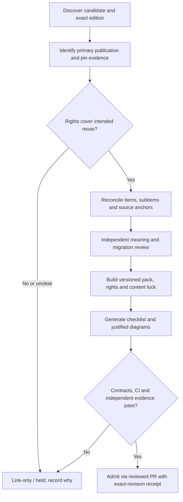

# Reporting guideline intake and publication

The **Canonical Standard Pack** is the authority for maintained checklist content. Markdown,
Typst, LaTeX, forms and diagrams are generated views; the earlier source-to-Markdown process
is a legacy compatibility path, **not** permission to publish extracted text. A YAML sidecar,
source file or green validator does not establish item completeness, redistribution rights or
methodological acceptance.

## Minimal admission flow

## Checklist for one edition (not one whole website)

- [ ] **Select authority.** Record guideline versus extension versus appraisal instrument,
  the edition/date, supersession, study type and intended audience. EQUATOR is a discovery
  index; confirm each claim at the *primary* issuing organisation/publication.
- [ ] **Pin provenance.** Record primary source URL/DOI, publisher, retrieval date, exact
  accessible source bytes and SHA-256 when retained, publication licence, attribution and
  modification notice. If the source bytes cannot be pinned, record that limitation.
- [ ] **Decide reuse.** Assess licence for the **specific edition and intended redistribution**,
  separately for checklist, figures, translations, explanation text and companion tools.
  If permission is unclear, keep a citation/link-only catalogue entry: do not copy text.
- [ ] **Reconcile structure.** Compare every printed item/subitem, section, page or stable
  anchor and wording to the primary source. Preserve item IDs separately from display
  numbers; never reuse another guideline's item array or trust a placeholder sidecar.
- [ ] **Review interpretation.** Independently check machine-normalized requirements,
  evidence expectations and applicability. Source-text fidelity is not interpretation
  validity. Record reviewer, source basis, corrections and unresolved ambiguity.
- [ ] **Protect migration.** Version the edition/extension and map older IDs explicitly.
  One-to-many mappings (as in PRISMA 2020) require reassessment, never automatic
  copying of a previous compliance decision to every new item.
- [ ] **Generate only from the pack.** Use the existing pack schema, item-level rights,
  source anchors, citations and lock; generate Markdown/other projections rather than
  treating a formatted output as authoritative input.
- [ ] **Qualify projections.** Check positive and rejected inputs, item/section/count
  conservation, generated-file drift, links, source/rights guards and a text equivalent
  for any diagram. Add diagrams only for real study flows, decisions or relationships:
  do not invent a participant-flow figure for every checklist.
- [ ] **Publish with limits.** Require ordinary protected PR checks and a revision-bound
  receipt; separately track human methodological, usability/accessibility and external
  acceptance. A passing build does not authorize a release claim.

## Candidates and boundaries

| Candidate | Treatment | Tracking |
| --- | --- | --- |
| CONSORT **2025** and its trial participant-flow diagram | Prioritize exact-edition source, 30-item and diagram qualification; do not relabel a 2010 extension as the 2025 base | [Current statement](https://www.bmj.com/content/389/bmj-2024-081123) |
| SPIRIT **2025** trial protocols | Qualify separately from CONSORT and from the older SPIRIT-AI extension | [EQUATOR source entry](https://equator-network.org/reporting-guidelines/spirit/) |
| CHEERS **2022** and CHEERS-AI | Resolve base versus extension and item-level reuse before economic-evaluation packs | [EQUATOR index](https://equator-network.org/reporting-guidelines/) |
| AGREE, ARRIVE, COREQ, RIGHT, SQUIRE, SRQR and other preserved candidates | Remain held / link-only until independently qualified; AGREE reporting versus appraisal needs an explicit scope decision | [Held-source issue #95](https://github.com/edithatogo/standards_check/issues/95) |

The [EQUATOR discovery catalogue (#111)](https://github.com/edithatogo/standards_check/issues/111)
and its [source-pinned PR #112](https://github.com/edithatogo/standards_check/pull/112)
may index public **descriptive metadata** in bulk. Do **not** bulk-admit checklist
items or commit third-party PDFs/checklist text without edition-specific permission.
Do not build a second importer. The [searchable guideline catalogue](https://equator-network.org/reporting-guidelines/)
is useful for discovery, not a single blanket redistribution licence. PRISMA 2020's
42-item fidelity and **unreviewed interpretations** are tracked separately in
[issue #82](https://github.com/edithatogo/standards_check/issues/82).

## Existing implementation

Use [Canonical Standard Pack](docs/architecture/CANONICAL_STANDARD_PACK.md),
[product guidelines](conductor/product-guidelines.md), [Track 01](conductor/tracks/01-canonical-standard-pack/plan.md)
and [Track 03](conductor/tracks/03-standardflow-import/plan.md) as the maintained contracts.
For already-cleared legacy inputs, `extract_docx.py` and `extract_all_docx.py` remain
compatibility utilities; they do not qualify new canonical content. Validate generated
legacy Markdown with `bash scripts/validate_md.sh` and `make validate`, and structured
packs with `python scripts/validate_packs.py` and `python scripts/validate_artifacts.py`.

## Optional human review

The [optional review policy](docs/development/optional-human-review.md) applies to
routine acquisition, deterministic source and structure checks, and independent
agent review. A human may inspect or correct any receipt but is not required to
start or complete those checks. Record the actual review type and evidence. A
source-reconciled pack is not an expert-validated interpretation; model-relative
candidates and unresolved rights or meaning remain held. Do not infer permission,
independent human adjudication or issuer approval from automated agreement.
