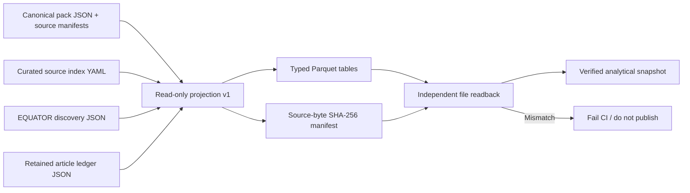

# T01.6: Parquet analytical projections

Tracking: [#149](https://github.com/edithatogo/standards_check/issues/149).
Owner: Track 01; Track 05 owns verification. Related #111 (discovery), #95 (held
legacy rights), #82 (PRISMA interpretation).

Status: implementation proposed; execution and receiving-main acceptance pending.
Base main: `83413e2dc64217539e962cc72a61f9fd127415d9`.
Tests-first commit: `a96696269e4d267c702ab7a28aa11452f1900980`.
Implementation commit: `d5c168640eafe29acb34f68048fdca93e91ec5b4`.
The authoring environment lacks PyArrow, Rust and GitHub network access; neither
a local RED nor GREEN run, make quick, nor full suite is claimed. Hosted CI must
execute the tests and generated snapshot before acceptance.

## Requirements (MoSCoW)

| Priority | Requirement |
| --- | --- |
| Must | Treat checked-in pack JSON, manifests, source index YAML, discovery JSON and retained article ledger as authority. |
| Must | Preserve stable identifiers, source order, row counts, source hashes, anchors, rights, verification status and nulls within the declared projection. |
| Must | Keep candidates/discovery separate; never infer canonical admission. |
| Must | Suppress verbatim, normalized and guidance text unless both pack and effective item rights are cleared; retain exact UTF-8 field fingerprints. |
| Must | Explicit Arrow schemas, exact ordered row readback, source and output SHA-256 manifest, reject missing/extra files, changed schema, changed values and duplicate identities. |
| Must | Reject overwriting an existing bundle or writing inside canonical source trees; no runtime modification. |
| Should | Generate deterministic Zstandard-compressed files, including typed empty tables, and retain CI artifacts with exact checkout receipt. |
| Could | Add projections of later reconciliation receipts or other typed sources when their stable grains and rights boundaries are established. |
| Won't | Add a database, Rust dependency, new source parser, inference, automatic admission, binary corpus copies or a second canonical model. |

## Design



| Table | Grain | Boundary |
| --- | --- | --- |
| packs | pack ID/version | Original verification and rights, source authority, counts, exact pack JSON hash |
| requirements | pack ID/version + requirement ID | Ordinal, printed ID, anchor, rights, evidence, separately hashed text fields; cleared text only |
| relationships | pack ID/version + ordinal | Original predicate and target (no inferred edges) |
| sources | pack ID/version + source ID | Manifest provenance; preserve optional hashes and redistribution flag |
| source_index | curated source ID | Declared metadata; not an admission assertion |
| equator_guidelines | guideline ID | Upstream revision, blob hash, URL, discovery status |
| candidate_editions | retained candidate edition | Source SHA, attribution, scope, expected row count; not an admitted pack |
| candidate_rows | edition + item ID | Ordinal, topic, anchor, source SHA and text fingerprint only |

The snapshot schema is `standardflow.analytics.v1`. Ordinals are zero-based
positions in source arrays; pack traversal is lexicographically sorted by
repository path. Dates/edition labels remain strings; nulls remain null.
No joins or inference occur during export; users can join the declared keys.
Candidate text, original binaries, notes, migration decisions and arbitrary
unstructured receipt content are outside this v1 projection. This is semantic
conservation of selected fields, not reconstruction of all canonical bytes.
The manifest binds the exact original input bytes. Existing canonical validators
and Rust lock checks remain separate and are not replaced by projection checks.
Byte reproducibility is tested within the same writer environment, not promised
across Arrow releases or platforms.

## Reproduction

```sh
python -m pip install -r requirements/python-tests.txt
python scripts/validate_packs.py
python -m unittest tests.test_parquet_projections -v
python -m scripts.project_parquet --output target/analytical-parquet
python -m scripts.project_parquet --check --output target/analytical-parquet
```

Use a fresh directory for each export. The current assurance workflow runs the
focused tests as part of pytest and writes/reads the snapshot within the existing
Python coverage artifact; checkout identity is bound by its commit.txt.
The manifest includes projection version, input paths and SHA-256, table row
counts and SHA-256. Full value comparison against freshly derived source rows
is required even if a modified file's digest has been updated. A missing,
invalid or altered input fails the command.

Dependency: Apache Arrow PyArrow 26.0.1 (Apache-2.0; https://pypi.org/project/pyarrow/26.0.1/).
Owner: Track 01. Purpose: use the maintained Arrow/Parquet writer and reader
rather than custom serialization. It is inventoried automatically by the
existing Python test-profile SBOM; no production Rust or browser dependency.
Removal: delete the additive script, test, CI step and pin; canonical files
and consumer runtime need no migration.

## Acceptance and evidence gates

- [x] Define tests before implementation; source commits above.
- [x] Add explicit schemas, derived writer, verifier, manifest and focused regressions.
- [x] Wire generation/readback into existing Assurance workflow and dependency inventory profile.
- [ ] Observe actual focused/full hosted tests, including live corpus and negative mutations.
- [ ] Observe exact-head required CI, dependency inventory and review.
- [ ] Verify receiving-main artifact, counts and exact checkout; record evidence here.

The inspected base has 42 PRISMA canonical requirements, 719 discovery records
and 82 candidate article-table rows in four editions. These are input counts
observed in the repository, not generated Parquet execution results.
No change to source admission, interpretation, rights review, migration, or
external validation gates.
