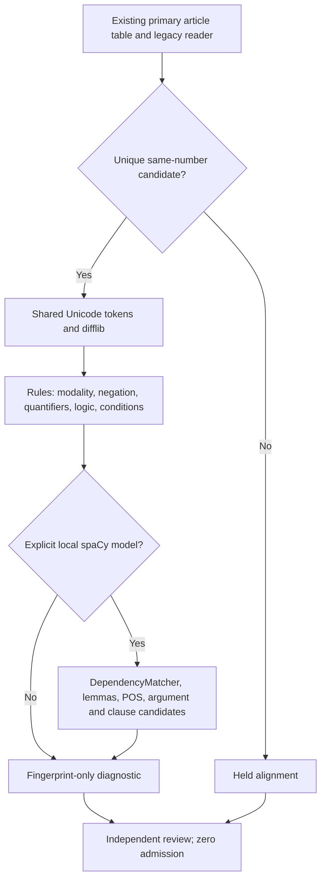

# T01.5d — classical linguistic NLP comparator

Scope: source preparation and discrepancy diagnosis. No change to canonical pack content, Rust
runtime, identity selection, rights decisions or methodological acceptance. Related #95 and #82.
Starting main: `83413e2dc64217539e962cc72a61f9fd127415d9`.

## MoSCoW requirements

| Priority | Requirement |
| --- | --- |
| Must | Preserve existing NFKC Unicode tokenization, separate exact text fidelity and token similarity; retain offsets and fingerprints without prose. |
| Must | Detect modal, negative, numeric and linguistic quantifier, logical and conditional/temporal cue changes. Treat them as diagnostics, not logical equivalence. |
| Must | Compare only unique same-number candidate rows; hold missing, duplicate or warned legacy alignments. Numbers are not source authority. |
| Must | Keep zero pack promotions and unchanged default reconciliation output. |
| Should | Provide an explicitly selected local spaCy reference for lemmas, POS, dependency matching, clause candidates and grammatical action/subject/object/evidence candidates. |
| Should | Record runtime/model identity; qualify exact pinned model bytes and independent family/edition holdout before acceptance. |
| Could | Benchmark RapidFuzz versus difflib on identical paired rows when baseline throughput is inadequate. |
| Won't | Download models in ordinary CI, infer full boolean scope, certify obligations or replace human interpretation; no NLI, Rust port or new storage service in this increment. |

## Design



Run the existing primary article reconciliation, with optional diagnostics:

```sh
python -m scripts.reconcile_authoritative_articles --linguistic --output /tmp/linguistic.json
python -m pytest --import-mode=importlib tests/test_classical_linguistic_nlp.py tests/test_reconcile_authoritative_articles.py
# In a separate reference environment with Python 3.13 and explicitly acquired trusted model files:
python -m pip install -r requirements/classical-nlp-reference.txt
python -m scripts.reconcile_authoritative_articles --spacy-model /path/to/local/english/model --output /tmp/linguistic-reference.json
```

The spaCy reference is optional; no install or model download is invoked by the comparator.
Dependency owner: Track 01; spaCy 3.8.11, MIT, solely an offline comparison reference.
Remove the optional requirement and omit the model option to roll back; rule-only diagnostics
do not require spaCy. Ordinary CI remains model-free. No external network calls.

## Evidence and limits

Isolated local Python 3.13.5 / pytest 9.0.2 / spaCy 3.8.11: RED missing module, then
four tests and eleven parameterized subtests passed, including real DependencyMatcher
against a manually annotated synthetic spaCy Doc, blank-pipeline rejection, bounds,
source-text non-disclosure, signed/percent quantifier differences and conditional/modality
differences. This is not evidence of a trained model's accuracy. Local checkout and full
repository suite unavailable (GitHub DNS blocked in execution environment); integrated tests
and exact-head CI remain pending. No trained model was installed locally. Runtime/model name
and version are reported when explicitly used; independently pin the model artifact bytes,
licence, and environment before claiming reference qualification.

Cue scope, grammatical roles and evidence candidates are heuristic; passive voice, coordinated
arguments, implicit actors, double negation, complex nested clauses and ambiguous quantities
require independent evaluation. A no-change finding is not proof of semantic identity. The
existing source text and legacy exact/closest matching dispositions are unchanged.
Offsets refer to the exact in-memory row text; hashes are not anonymization and still require
rights-appropriate access controls. No raw new checklist prose is written by the diagnostic.

Next acceptance: independent family/edition holdout with reviewed expected discrepancy
labels (not legacy self-labels), actual trained spaCy model and exact model digest,
scope and role counterexamples, paired precision/recall and abstention/false-acceptance
metrics, resource measurements and exact-head/receiving-main CI. Retain this checkbox open
until observed, not merely configured. RapidFuzz is deferred until a measured need.
