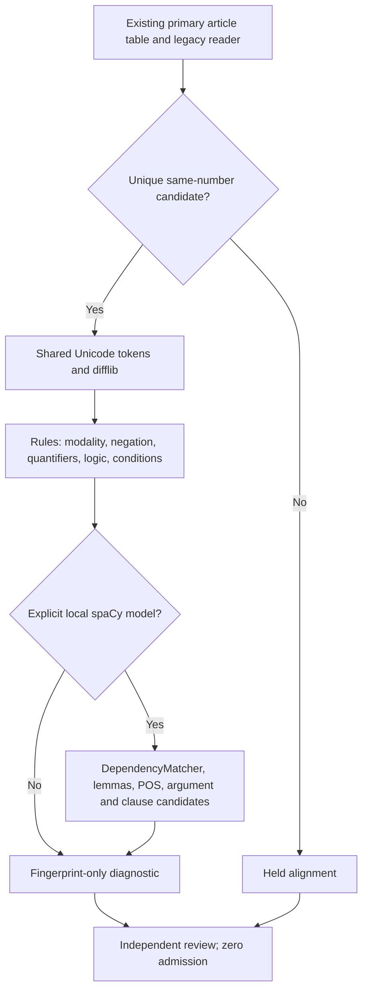

# T01.5d — classical linguistic NLP comparator

Scope: source preparation and discrepancy diagnosis. No change to canonical pack content, Rust
runtime, identity selection, rights decisions or methodological acceptance. Related #95 and #82.
Starting main: `83413e2dc64217539e962cc72a61f9fd127415d9`.

## MoSCoW requirements

| Priority | Requirement |
| --- | --- |
| Must | Preserve existing NFKC Unicode tokenization, separate exact text fidelity and token similarity; retain offsets and fingerprints without prose. |
| Must | Detect modal, negative, numeric and linguistic quantifier, logical and conditional/temporal cue changes. Treat them as diagnostics, not logical equivalence. |
| Must | Compare only unique same-number candidate rows; hold missing, duplicate or warned legacy alignments. Numbers are not source authority. |
| Must | Keep zero pack promotions and unchanged default reconciliation output. |
| Should | Provide an explicitly selected local spaCy reference for lemmas, POS, dependency matching, clause candidates and grammatical action/subject/object/evidence candidates. |
| Should | Record runtime/model identity; qualify exact pinned model bytes and independent family/edition holdout before acceptance. |
| Could | Benchmark RapidFuzz versus difflib on identical paired rows when baseline throughput is inadequate. |
| Won't | Download models in ordinary CI, infer full boolean scope, certify obligations or replace human interpretation; no NLI, Rust port or new storage service in this increment. |

## Design



Run the existing primary article reconciliation, with optional diagnostics:

```sh
python -m scripts.reconcile_authoritative_articles --linguistic --output /tmp/linguistic.json
python -m pytest --import-mode=importlib tests/test_classical_linguistic_nlp.py tests/test_reconcile_authoritative_articles.py
# In a separate reference environment with Python 3.13 and explicitly acquired trusted model files:
python -m pip install -r requirements/classical-nlp-reference.txt
python -m scripts.reconcile_authoritative_articles --spacy-model /path/to/local/english/model --output /tmp/linguistic-reference.json
```

The spaCy reference is optional; no install or model download is invoked by the comparator.
Dependency owner: Track 01; spaCy 3.8.11, MIT, solely an offline comparison reference.
Remove the optional requirement and omit the model option to roll back; rule-only diagnostics
do not require spaCy. Ordinary CI remains model-free. No external network calls.

## Evidence and limits

Isolated local Python 3.13.5 / pytest 9.0.2 / spaCy 3.8.11: RED missing module, then
four tests and eleven parameterized subtests passed, including real DependencyMatcher
against a manually annotated synthetic spaCy Doc, blank-pipeline rejection, bounds,
source-text non-disclosure, signed/percent quantifier differences and conditional/modality
differences. This is not evidence of a trained model's accuracy. Local checkout and full
repository suite unavailable (GitHub DNS blocked in execution environment); integrated tests
and exact-head CI remain pending. No trained model was installed locally. Runtime/model name
and version are reported when explicitly used; independently pin the model artifact bytes,
licence, and environment before claiming reference qualification.

Cue scope, grammatical roles and evidence candidates are heuristic; passive voice, coordinated
arguments, implicit actors, double negation, complex nested clauses and ambiguous quantities
require independent evaluation. A no-change finding is not proof of semantic identity. The
existing source text and legacy exact/closest matching dispositions are unchanged.
Offsets refer to the exact in-memory row text; hashes are not anonymization and still require
rights-appropriate access controls. No raw new checklist prose is written by the diagnostic.

Next acceptance: independent family/edition holdout with reviewed expected discrepancy
labels (not legacy self-labels), actual trained spaCy model and exact model digest,
scope and role counterexamples, paired precision/recall and abstention/false-acceptance
metrics, resource measurements and exact-head/receiving-main CI. Retain this checkbox open
until observed, not merely configured. RapidFuzz is deferred until a measured need.

## Frozen challenge and reference qualification — follow-up

Previous PR head `154c760188915d9db3a4e1fdf1de72a314537954`: eight hosted workflows
completed successfully, but Codecov patch coverage was **61.01% versus 80% required by the
advisory target** ([Assurance run](https://github.com/edithatogo/standards_check/actions/runs/45384358540)).
Offline AI security remained queued. Do not transfer these results to the new head.

The [frozen challenge](../../../scripts/linguistic_benchmark.py) has 17 synthetic cases
(scope, passive voice, explicit/implicit actors, object changes, double negation,
coordinated arguments, nested conditions and meaning-preserving controls). It also
selects eight distinct rows from two separately sourced guideline families (PRISMA-S 2021
and CHEERS 2022), yielding eight source-backed single mutations and eight unchanged
controls, **33 total pairs**. The existing snapshot validator checks the source identity,
ordered row digest and anchor; the mutations are applied in memory and reports retain only
hashes and case IDs. Neither family is used to tune the comparator in this follow-up.
These are author-defined perturbation labels, NOT independently reviewed human labels or
an untouched external dataset. Keep independent family/edition qualification open.
Do not tune on these frozen cases and subsequently report them as held-out results.

Publisher reference: [spaCy en_core_web_sm 3.8.0](https://github.com/explosion/spacy-models/releases/tag/en_core_web_sm-3.8.0),
MIT, CPU pipeline, spaCy 3.8.11, wheel size 12,806,118 bytes, publisher SHA-256
`1932429db727d4bff3deed6b34cfc05df17794f4a52eeb26cf8928f7c1a0fb85`.
The reference loader rejects wrong bytes, runtime version, model version/name and licence.
No model package code is installed; the exact verified wheel is extracted into a temporary
directory and loaded as local pipeline data. Ordinary unrelated CI does not acquire it;
a relevant NLP change or explicit assurance dispatch does. The existing coverage artifact
retains matched fixture fingerprints, source pins, per-case expected/observed diagnostics,
field-level TP/FP/FN, precision/recall, held and material-no-signal counts, control false
alerts, comparison time, process peak RSS and the resolved package inventory. Hosted
timing/RSS include coverage instrumentation; use separate plain runs for operational timing.

Local RED: missing benchmark module. GREEN (Python 3.13.5 / pytest 9.0.2 / spaCy 3.8.11):
12 passed, 11 subtests passed, one skipped because the isolated container has no retained
source ledger. The three new/updated code and test files' exact Git blob hashes were verified
before push. Publisher wheel download was attempted locally and failed; do not claim
trained inference or source replay from the isolated local run. The new hosted run must
execute both methods on the same 33 cases and preserve actual receipt bytes.

Synthetic rules baseline, fixture SHA-256
`8c2f58d2f4a661747be03463d7db3421336e1be8fd82f89f5c47b5ca5eb2d7a1`:
17 pairs, TP 7, FP 2, FN 7, micro precision 77.78%, micro recall 50%,
13 material-change cases, 6 with no diagnostic signal, 0 held, 4 controls, 1 false alert,
comparison time 0.00196 s, peak RSS 98,316,288 bytes (one local uninstrumented run).
These are challenge-set observations, not generalizable error rates or acceptance thresholds.
The missed cases include argument substitution, passive agent changes, double negation,
coordinated arguments and altered parenthetical scope. No-change diagnostics do not
authorize admission. Compare paired reference improvement and false alerts first; design
a separate reviewed family-level evaluation before determining acceptance criteria.

Remaining: actual pinned-wheel execution and receipt, exact-head and receiving-main
checks, Codecov patch target, independently reviewed labels and additional untouched
guideline families with an agreed acceptance criterion. Do not close #95/#82 or T01.5d
on a configured workflow or on synthetic results.
