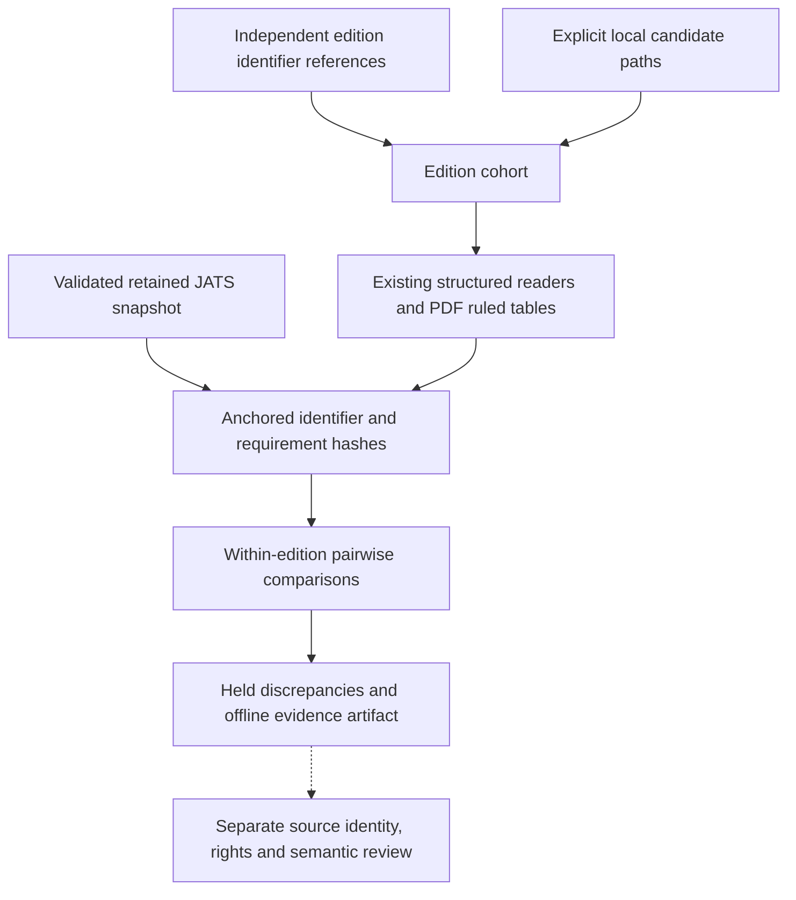

# Cross-family structural format benchmark

Track 01 T01.5b/c/h; [#111](https://github.com/edithatogo/standards_check/issues/111),
[#95](https://github.com/edithatogo/standards_check/issues/95) and #82.
Baseline main `83413e2dc64217539e962cc72a61f9fd127415d9`. This slice is independent of the active
PDF/NLP and Parquet implementation branches.

## Requirements (MoSCoW)

| Priority | Requirement |
| --- | --- |
| Must | Reuse the ID/header comparison with independently recorded edition-specific ordered denominators; never use legacy arrays as truth. |
| Must | Retain candidate path, byte SHA-256, anchors, normalized digest, missing/extra/duplicate IDs, order, unknown denominators, parser failure and differences. |
| Must | Compare only within an explicit edition; label candidate identity, format, identical bytes and lack of proven independence. |
| Must | Preserve the EcoEvo API and evidence boundary; no admission or candidate prose in artifacts. |
| Should | Cover priority/held families and retained article snapshots; report absent candidates. |
| Should | Emit one offline revision-bound CI artifact with existing readers. |
| Could | Consume independent PDF/JATS/HTML receipts and Parquet projections after their producer contracts are accepted. |
| Won't | Automatically migrate versions, admit by majority vote, acquire sources over the network, infer semantic equivalence from hashes, or pool family denominators. |



Fourteen cohorts cover EcoEvo, PRISMA-P/S/abstracts, CHEERS, ARRIVE,
CONSORT, SPIRIT, STARD, STROBE, TRIPOD+AI, SRQR, COREQ and SQUIRE.
STROBE lacks an independently established numbered denominator in the
priority manifest; TRIPOD+AI has no local candidate rather than using
TRIPOD 2015. Expanded checklists, schedules, translations and different
editions are not silently substituted. Candidate filenames do not prove
identity. Retained primary article tables are validated against existing
source and row-digest pins, not treated as newly extracted XML.
Same-byte and same-format comparisons are labelled. Digest equality is
not semantic or methodological validation.

## Reproduction

```sh
python -m pytest --import-mode=importlib tests/test_compare_guideline_formats.py tests/test_compare_ecoevo_formats.py
python -m scripts.compare_guideline_formats --root . --output /tmp/guideline-format-comparison.json
```

The PDF ruled-table extraction is a bounded diagnostic, not an independent
second full-row parser. Incomplete headers, merged/inherited cells, non-body
content, nested subitems and unknown denominators remain limitations.
No held-out accuracy, rights or canonical pack promotion is claimed.
Rollback removes the driver and CI invocation and restores default-only
helper signatures; historical receipts remain immutable.

## Evidence status

Regression specifications precede implementation on this branch. The local
execution container cannot resolve GitHub, so checkout-based RED/GREEN
and full-suite tests have not been executed locally. Hosted and receiving-main
receipts must be observed before acceptance. No source counts or test passes
are asserted here.

## Receiving-main reconciliation

Historical artifact [14914864611](https://github.com/edithatogo/standards_check/actions/runs/45384270600/artifacts/14914864611), SHA-256 cf4277cd8b07780dee5b14305f0450afbfd8c428e87b23f2c3beaa58ea4d892d, inspected. All 14 cohorts reported, but generic header aliases recovered zero EcoEvo IDs in all four formats despite later #156 qualification. Four retained JATS snapshots recovered 82 rows; PRISMA-P and abstracts DOCX recovered 26/12 rows. Trial, other PDF and missing-source holds retained; no pooled denominator or promotion.

Reconcile latest receiving main (including #145 maintained pins, #154 classical comparator and #156 PDF grid). Preserve existing strict fingerprints and separate layout-aware comparison. EcoEvo uses its original specific subitem header and the qualified native/Poppler PDF readers, not generic ruled-table extraction. New regressions cover ambiguous main/subitem aliases and actual synthetic independent grid replay. Actual old cohort artifact is the reproduced RED evidence; local complete checkout and new tests not executed here, require hosted suite and actual artifact inspection. No new parser/runtime or rights promotion. Other formats stay diagnostic/held.
