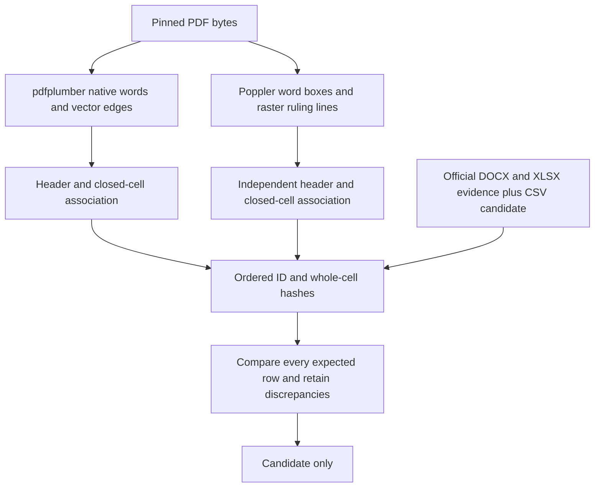

# EcoEvo independent geometric reconstruction

Track 01 T01.5c; #111/#95/#82. Starting main f5ec541. Previous official
PDF hash db0a9fb221a1467a82c277419be96e18c7f8600b0deed25009bacb41322623ba
was byte-identical to the official download. Previous engines produced 0
full rows despite 89 Poppler identifier tokens; preserve that receipt.

## MoSCoW

- Must: independent native PDF geometry and Poppler bounding boxes plus raster
  ruling lines from the same pinned bytes; shared row-association contract,
  no use of the other engine's cell output. Explicit multiline header,
  column bindings, merged topic cells, closed bands, native anchors.
- Must: verify all 89 printed IDs in order, distinct complete row fingerprints,
  actual cross-format pairwise discrepancies and parser disagreement.
- Must: hold ambiguous unnumbered continuation, missing borders and duplicate
  IDs; never promote from extraction agreement. No raw source text in artifacts.
- Should: compare complete requirements to independently verified official
  DOCX/XLSX and candidate CSV, preserve punctuation and substantive glyphs.
- Could: additional parser only after failure analysis; no OCR by default.
- Won't: infer rows from ID counts, copy legacy text or admit a pack.

Independent geometry acquisition uses two rendering/text engines; the
row-association algorithm is shared, so common-mode error remains possible.
Closed page-tail cells are now eligible rather than indiscriminately held;
ambiguous next-page leading bands invalidate the previous tail. Unproven
continuation is not silently concatenated. No new package beyond the existing
pdfplumber/Pillow and NumPy transitive test stack; Poppler already used by CI.
The four focused synthetic regressions passed locally (real two-page ruled
PDF with wrapped cells and merged topic; missing/ambiguous header and border
holds). Actual source replay requires hosted execution. Keep prior failed
receipt immutable; compare source and exact revision before qualification.
