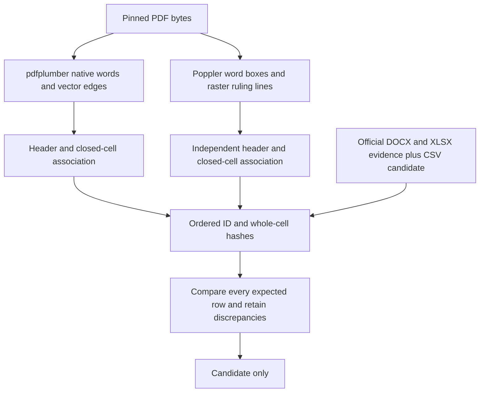

# EcoEvo independent geometric reconstruction

Track 01 T01.5c; #111/#95/#82. Starting main f5ec541. Previous official
PDF hash db0a9fb221a1467a82c277419be96e18c7f8600b0deed25009bacb41322623ba
was byte-identical to the official download. Previous engines produced 0
full rows despite 89 Poppler identifier tokens; preserve that receipt.

## MoSCoW

- Must: independent native PDF geometry and Poppler bounding boxes plus raster
  ruling lines from the same pinned bytes; shared row-association contract,
  no use of the other engine's cell output. Explicit multiline header,
  column bindings, merged topic cells, closed bands, native anchors.
- Must: verify all 89 printed IDs in order, distinct complete row fingerprints,
  actual cross-format pairwise discrepancies and parser disagreement.
- Must: hold ambiguous unnumbered continuation, missing borders and duplicate
  IDs; never promote from extraction agreement. No raw source text in artifacts.
- Should: compare complete requirements to independently verified official
  DOCX/XLSX and candidate CSV, preserve punctuation and substantive glyphs.
- Could: additional parser only after failure analysis; no OCR by default.
- Won't: infer rows from ID counts, copy legacy text or admit a pack.

Independent geometry acquisition uses two rendering/text engines; the
row-association algorithm is shared, so common-mode error remains possible.
Closed page-tail cells are now eligible rather than indiscriminately held;
ambiguous next-page leading bands invalidate the previous tail. Unproven
continuation is not silently concatenated. No new package beyond the existing
pdfplumber/Pillow and NumPy transitive test stack; Poppler already used by CI.
The four focused synthetic regressions passed locally (real two-page ruled
PDF with wrapped cells and merged topic; missing/ambiguous header and border
holds). Actual source replay requires hosted execution. Keep prior failed
receipt immutable; compare source and exact revision before qualification.

First actual [grid replay artifact 14920191118](https://github.com/edithatogo/standards_check/actions/runs/45393167595/artifacts/14920191118), tested merge c068b25b77cfef58d9c7c30882b926588c07f128: zero full rows, both headers held. Native long vector edges only at outer left/right; rendered dark-column totals picked up text strokes. Exact PDF hash matches. Add virtual separators from independent header words, ID geometry and horizontal boundaries; no inferred complete row absent closed outer and horizontal evidence. Missing-inner-rules synthetic PDF failed RED on both engines, then passed GREEN; five focused tests passed. Retain failure receipt.

Second actual [replay artifact 14918879314](https://github.com/edithatogo/standards_check/actions/runs/45393802588/artifacts/14918879314): zero rows; native and Poppler header geometry identifies three stacked words Sub / item / number and the separate Sub-item column. Native horizontal rules bound groups of numbered items rather than each item. Bind subitems to aligned first lines within closed groups, not assumed row heights. Use full-width native rules and rendered intensity transitions. New merged-group regression failed RED on both engines then passed GREEN; six focused tests passed locally. Actual gate remains required.

Third actual [replay artifact 14919189564](https://github.com/edithatogo/standards_check/actions/runs/45394531592/artifacts/14919189564): both parsers recovered 89/89 identifiers in exact order and the same group boundaries; four comparable row fingerprints agreed between engines but disagreed with all other formats. Source identifiers are centred against multi-line paragraphs. A first-line-only alignment is inadequate. Require a unique contiguous partition of all requirement lines matching top- or centre-aligned IDs. Centred-number regression failed RED then passed GREEN; seven local tests passed. Actual replay and cross-format comparison still required.

### First complete pinned-source replay

[Run 45395057090](https://github.com/edithatogo/standards_check/actions/runs/45395057090), [artifact 14921045838](https://github.com/edithatogo/standards_check/actions/runs/45395057090/artifacts/14921045838), merge revision 12264fb1159143734851cb03388852645e488d85: the dedicated gate passed. Both parsers reconstruct 89/89 non-null fingerprints in exact expected order, no geometry issues, no duplicate or extra IDs. Independent exact agreement 88/89 (22.1 differs; mathematical superscript layout is a plausible explanation, not adjudicated). Native vs DOCX/XLSX 83/89, Poppler 82/89; DOCX/XLSX 89/89; CSV differs from them on 8.3. Native differing IDs 3.1, 7.6, 14.1, 19.4, 23.1, 26.2; all concern compound-word typography in the published PDF. Preserve strict hashes; do not assert equivalence without additional evidence. All 89 items compared. No pack promoted.

Review follow-up: direct-script import compatibility; unclosed trailing requirement text outside the final band now holds the last row, except precisely recognised EcoEvo page furniture. Both unclosed-tail regressions failed RED then passed GREEN. Ten focused local tests passed. Require fresh hosted replay on the reviewed revision before merging.

### Reviewed replay and typography diagnostic

[Run 45395667120](https://github.com/edithatogo/standards_check/actions/runs/45395667120), [artifact 14921460687](https://github.com/edithatogo/standards_check/actions/runs/45395667120/artifacts/14921460687): tested merge b1ca296bad7a7a823190c42ac0a7f43dae1e56f1 again passed 89/89 complete items per engine. Diagnostic hash reproduction using the public PDF text showed that each of the six compound-word differences matches exactly after removing the line-break space following a retained hyphen. Item 22.1 Poppler hash matches separated superscript/punctuation tokens; native, DOCX and XLSX match the joined form. Add a separate geometry-aware fingerprint (not overwrite strict source text hashes): preserve hyphen, remove only line-end wrapping space, and join smaller raised numeric glyphs/punctuation only with a unique adjacent base. Held rows cannot qualify via alternate hashes. Eleven focused tests passed; replay actual bytes to inspect resulting alternate comparisons, retain any remaining discrepancy.
