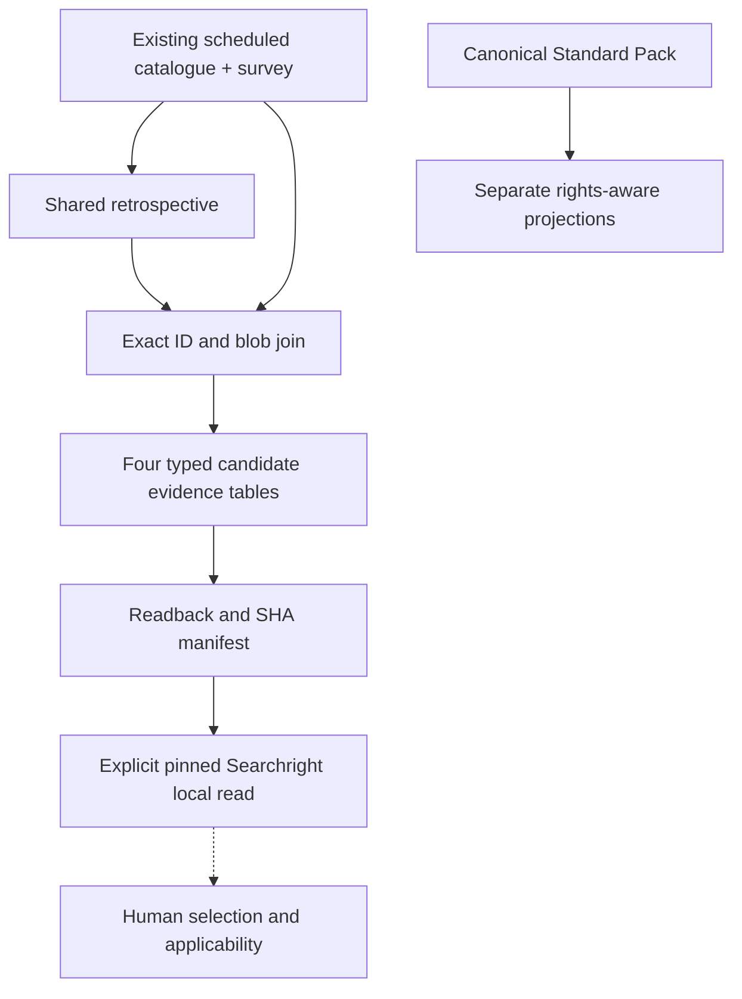

# Versioned EQUATOR analytical snapshot (Track 01 / Track 04)

Refs #111, #95, #82; consumer [Searchright #843](https://github.com/edithatogo/searchright/issues/843).

## MoSCoW

- **Must:** exact source revision, complete identity/blob join, immutable input hashes and zero promotions; four typed Parquet tables, Zstandard, readback conservation, local-only consumer and explicit held discovery statuses.
- **Should:** integrate with the existing scheduled acquisition and retrospective workflow, retain SHA-bound manifests and use the existing exporter, not a new service or crawler.
- **Could:** independently reviewed version-pin release to durable storage after producer/consumer tests and rights review; artifact retention is not a release.
- **Won't:** re-pin canonical source, substitute held candidate text for a pack, auto-select a guideline or alter Searchright review state or PRISMA counts.

The manifest schema is `dev.standardflow.equator-analytical-snapshot.v1`:
producer_repository, producer_revision (exact 40-hex tested checkout),
source_revision (exact upstream 40-hex), input_sha256s (catalogue, survey,
retrospective), origin (scheduled_or_live or historical_replay),
canonical_packs_promoted=0, claim_boundary, polars_version, tables
(mapping table names to rows, sha256, explicit typed schema). Manifest SHA is
the consumer's external explicit pin; artifacts retained 90 days are not
permanent releases. Replay origin must not be presented as a fresh run.

`catalogue_identity` holds stable equator ID, upstream blob/revision, page URL,
title/acronym, study/clinical/report-section metadata (JSON arrays), declared
and resolved DOI/PMID/PMCID, status and identity-conflict flag; all rights
unassessed, discovery_only or held_identity_conflict. `acquisitions` contains
edition status and counts, `acquisition_items` contains ordered fingerprint
and anchors only, `review_findings` contains shared retrospective record and
code. All acquisition dispositions remain held_review. No unreviewed source
text in these projections. No canonical pack is changed.

Initial local replay of inspected artifact 14907858153 (source revision
d74413b15d266334067e1e5c104957601be3ba6c) returned 720 identities, 145 acquisition
records, 95 item fingerprints, 2241 review findings. Two synthetic tests
failed RED (missing module), then passed GREEN for exact joins/holds and
mismatch/nonzero-promotion rejection. Polars absent locally. Exact replay and
round-trip required on hosted CI; live scheduled artifact separately required.
The temporary pinned historical replay job can be retired after receiving-main
live projection succeeds. Preserve prior source failures/retained evidence.
