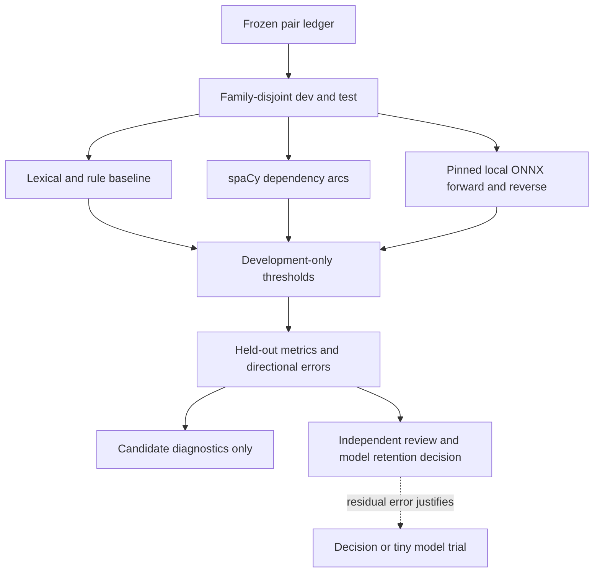
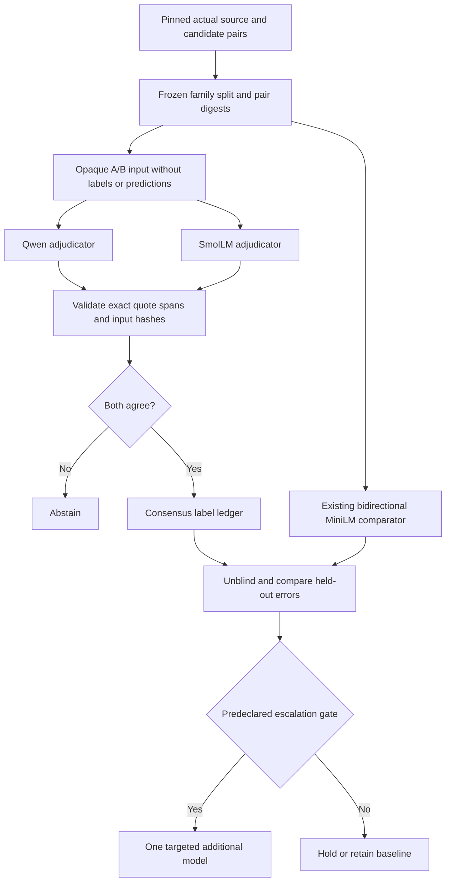

# Semantic reconciliation qualification (T01.5d–g)

## MoSCoW and evidence boundary

- **Must:** separate guideline families between development and held-out evaluation; preserve source fingerprints, both NLI directions, contradiction and neutrality; calibrate only on development cases; record false acceptance, false holds, coverage, per-family outcomes, runtime and exact model hashes.
- **Must:** candidate-only recommendations, never rights, methodological review, or canonical admission. Missing model/labels/overlong pairs are held, not truncated or interpreted as agreement.
- **Should:** compare lexical, classical marker, dependency-only and combined classical/dependency scores against bidirectional NLI using the same frozen cases. Evaluate paired errors and uncertainty on independently labelled actual guideline families before selecting a production method.
- **Could:** benchmark a decision model or tiny generative model only when held-out evidence identifies a residual error that such a model could plausibly resolve. Verify exact licence, artifact/runtime compatibility, structured output, and source-span accuracy first.
- **Won't:** download models in routine regression CI or execute remote model code; introduce a service, vector store or auto-approve any candidate.



## First experiment

Thirty-six original synthetic pairs (12 dev, 24 held-out): PRISMA and CHEERS
dev; CONSORT, STARD, ARRIVE and TRIPOD held-out. Exact, active/passive,
conjunction removal, numerical changes, negation, unrelated and reverse
implication. These are analyst-authored labels frozen before execution,
**not independent clinical/methodological adjudication or real guideline pairs**.
No verbatim guideline text added.

Fixed model: [cross-encoder/nli-MiniLM2-L6-H768](https://huggingface.co/cross-encoder/nli-MiniLM2-L6-H768)
revision c847a3c0e1cad93a5343183ef183f3044e3fc7c2; Apache-2.0; quantised
ONNX AVX2 file SHA-256 44391a5241a62e0083c1a8899a71e69a092b95aea5ba89e14062925468eceac7.
Official config label order contradiction/entailment/neutral. No remote code,
no Hugging Face inference. Hosted CPU runs explicitly when experimental inputs
change or manually dispatched. spaCy en_core_web_sm 3.8.0 is a reference
pipeline; record exact installed versions and CPU. Do not infer training
independence of external model from our family split.

Predeclared threshold grid .5/.6/.7/.8/.9/.95/.99/1.01. Select max dev true
accepts at zero dev false accepts, break ties at higher threshold. 1.01 is
abstain-all. Test metrics are descriptive for this tiny curated benchmark
and not production operating thresholds. NLI scores must have finite
probabilities in both directions, both top labels entailment; report the full
directional confusion. Exact surface agreement remains separately reported.

## Independent actual-source qualification — blinded model subagents

No human labelling or adjudication is required for this benchmark. Use two
stateless model-agent processes with distinct pinned Apache-2.0 GGUF weights
(Qwen2.5-1.5B-Instruct and SmolLM2-1.7B-Instruct), neither the MiniLM comparator.
Freeze the family-disjoint actual-source and candidate pair ledger before
inference. Give each agent only opaque ID and A/B text; hide guideline-family
split, constructed control class, other votes, and algorithmic predictions.
Use independently generated structured five-class judgements and exact unique
supporting spans. Invalid, missing, or conflicting votes abstain. Never
fabricate a third adjudication or equate agreement with ground truth.

Source-derived controls cover equivalent, additional obligation (narrower),
weakened obligation (broader), negation (contradictory), and different
requirements (indeterminate); the agents independently assess the actual
relationship rather than receive those intended classes. Keep real legacy
discrepancies separate from constructed controls. Reuse exact source and
table pins; unavailable or changed sources stay held. No source text, agent
quotes, or private pair files in public artifacts. Record model revisions,
weight hashes, prompts, input digests, span offsets, runtime, coverage and
per-class agreement and errors. PRISMA is development; CHEERS, CONSORT and
TRIPOD are held out when their exact source pins can be replayed.

Escalation gate predeclared: at least ten held-out consensus pairs, at least
two held-out families and 50% agreement coverage; at least two false
equivalences or two errors within a class with at least three consensus
examples. Only then evaluate one targeted additional NLI or decision model.
If insufficient agreement, report an adjudication deficit, not a comparator
accuracy claim. Small models are fallible and may share training biases.
The benchmark is automated candidate evidence, not rights, methodological
authority, or canonical admission. Existing external admission gates remain
distinct.



Four isolated RED/GREEN tests passed for blinding, span validity,
directionality and escalation gating. Actual model-agent and real-source
execution must be established by its hosted receipt; this plan is not a
claim of completed adjudication.

## Reproduction

```sh
python -m unittest tests.test_semantic_benchmark -v
python -m scripts.semantic_benchmark --cases contracts/examples/semantic-reconciliation-synthetic-v1.json --assets /path/to/pinned-assets --output /tmp/semantic-receipt.json --revision "$(git rev-parse HEAD)"
```

Three isolated RED/GREEN tests of the deterministic scoring/split core passed
locally. Full code and actual model/dep execution require hosted artifacts.
No decision/tiny-model benchmark is justified before seeing residual held-out
errors. The user requested a benchmark, not admission. Track 05 remains the
independent qualification owner. #111/#95/#82; depends on #150.

## Second controlled qualification: five classes and independently blinded agents

First actual receipt 14920298460: 3/22 consensuses, 19 abstentions; invalid/missing quote spans dominated. Qwen1.5B seven non-abstentions, SmolLM1.7B nine; several direction errors. Replace generated quotations with numbered input-line evidence (selection is checked against exact offsets, not claimed proof of reasoning); upgrade to independent Qwen3-4B and Phi-4-mini quantized GGUF processes. No human labelling. Weight provenance: [Open4bits Qwen3](https://huggingface.co/Open4bits/Qwen3-4B-Instruct-2507-GGUF/blob/7ddd64cfdb879bd66e42cdf94c11debd3d596ee7/qwen3-4b-instruct-2507-Q4_K_M.gguf), [Phi-4-mini MIT quantization](https://huggingface.co/GainPublications/Phi-4-mini-instruct-GGUF); check exact published SHA-256, resolve Phi's repository revision before download and record it. Both are third-party quantizations, no remote executable code, no production dependency.

Use PRISMA-P development, CHEERS and SPIRIT held out. SPIRIT's repository DOCX SHA-256 `9159179d53b65f2615135c554e661d40259eedb2d61318c890617f4a49bd1f2d` and exact independent 53-ID sequence must reproduce; candidate document, not refreshed primary authority. Each family supplies four bounded real rows, forming two independent-check pairs; derive five controlled relationship labels per pair by enumerated truth sets. State independence explicitly in the controlled examples. Equal, strict subset/superset, disjoint and overlapping incomparable sets give the five classes. No labels or predictions supplied to judges; natural observed legacy pairs stay unlabelled unless both agents agree. Do not extrapolate formal control results to natural requirements.

**Prespecified gates:** both agents ≥80% accuracy on development controls; ≥10 held-out consensus controls, ≥50% coverage, ≥90% agreement with independent truth-table reference, correct consensus across all five classes and ≥2 held-out families. Report all abstentions. Separate additional-comparator gate on independent formal controls: at least ten held-out pairs across two families and at least two false equivalences or two errors in a class with ≥3 examples. If eligible, compare [DeBERTa-v3-xsmall](https://huggingface.co/cross-encoder/nli-deberta-v3-xsmall/commit/03d06b2f6f06023bd596151a16477e2fcec601fb), Apache-2.0 quantized ONNX (published SHA-256 checked), against MiniLM with identical fixed five-class mapping and .95 equivalence threshold; report paired fixed/introduced errors. No additional model on failed gate, no production promotion. The new held-out cohort is independent of the earlier tiny synthetic threshold experiment, but intentionally constructed controls not external natural ground truth.

Four isolated tests were run RED (missing module) and GREEN (all pass) on the deterministic core. Full source preparation, model inference and exact-head CI require hosted receipts. No ordinary CI model downloads. Workflow artifacts exclude both input text and weights.

## Actual second experiment and witness-protocol correction

[Run 45398138785](https://github.com/edithatogo/standards_check/actions/runs/45398138785), [artifact 14922043306](https://github.com/edithatogo/standards_check/actions/runs/45398138785/artifacts/14922043306), tested merge `795a2b26b01afa63581d969fa19afab3f8acf2ad`; ZIP SHA-256 `8be81cbe6c8c60811fbe793424f7f52fcfbe60eb0ad13d62792ae89dcceb258b`; receipt SHA-256 `ee6f4f73d1e987221816b2c5e8eafd0165bf5728de64060c1dea45b2c1c846db`. 30 formal controls across PRISMA-P, CHEERS and SPIRIT, six observed legacy pairs. Both dev accuracies 60%; held-out agreement 7/20 (35%), all seven correct (three equivalent, four contradictory); three classes absent. Gate failed. All sources obtained; observed natural held-out consensus one of two, neither NLI model agreed with it. The formal-control escalation gate passed: MiniLM 12/20 correct, DeBERTa 18/20, six fixed/zero introduced, zero false equivalences among 16 non-equivalent controls for both, scoring 0.580s and 0.758s. Class correct counts (equivalent/narrower/broader/contradictory/indeterminate): MiniLM 3/2/2/4/1; DeBERTa 4/4/4/4/2. No production replacement or admission. The residual problem is direction-of-implication judgement, not unavailable evidence spans.

Keep all thresholds unchanged. **Witness protocol v2:** each blinded judge evaluates which of four independently specified report scenarios satisfies each formal requirement separately. Do not show reference masks, classes, comparator predictions or other votes; deterministic relation calculation is applied only to model-generated scenario sets, with invalid sets or evidence selections abstaining. Retain both vote arrays and protocol/prompt hashes. Natural pairs still use the original direct five-class judge, and are never assigned formal truth-set labels. Use ranks 4–7 of the previously frozen source-row selection for existing families, disjoint from the previous anchors; additionally attempt pinned repository CONSORT 2025 DOCX (exact 42-ID sequence, Git blob a1bf7fa3b9c019c5360750cd4981db73cccc3add, SHA-256 computed and retained). No publisher-authority promotion. Same prespecified gates on the new control cohort; family effects already observed from the prior experiment limit external generalization. Phi weight repository now fixed to the exact observed revision a8bb35ae595c241309e8186ec19690dd3b6b01e7. Four focused witness tests RED missing module then GREEN; new actual benchmark required. Do not weaken or waive consensus gate.
