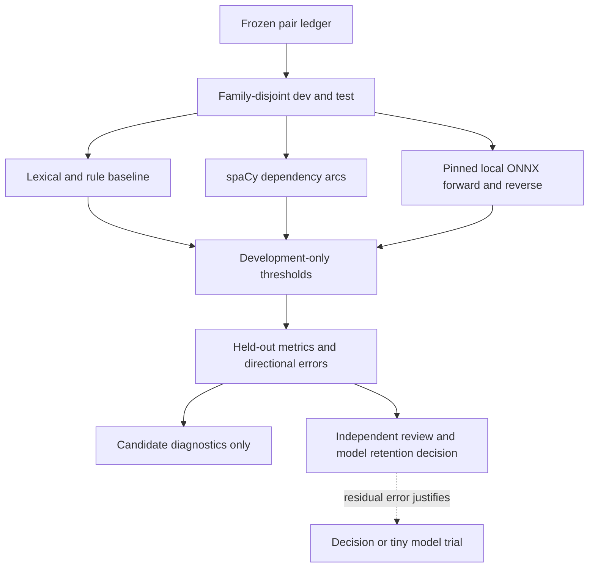
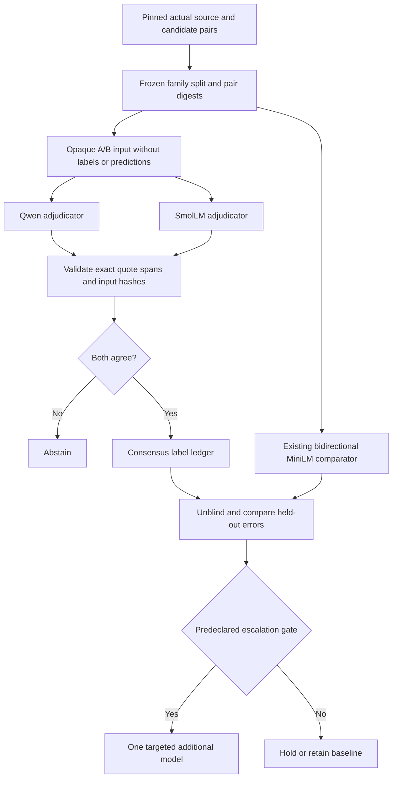

# Semantic reconciliation qualification (T01.5d–g)

## MoSCoW and evidence boundary

- **Must:** separate guideline families between development and held-out evaluation; preserve source fingerprints, both NLI directions, contradiction and neutrality; calibrate only on development cases; record false acceptance, false holds, coverage, per-family outcomes, runtime and exact model hashes.
- **Must:** candidate-only recommendations, never rights, methodological review, or canonical admission. Missing model/labels/overlong pairs are held, not truncated or interpreted as agreement.
- **Should:** compare lexical, classical marker, dependency-only and combined classical/dependency scores against bidirectional NLI using the same frozen cases. Evaluate paired errors and uncertainty on independently labelled actual guideline families before selecting a production method.
- **Could:** benchmark a decision model or tiny generative model only when held-out evidence identifies a residual error that such a model could plausibly resolve. Verify exact licence, artifact/runtime compatibility, structured output, and source-span accuracy first.
- **Won't:** download models in routine regression CI or execute remote model code; introduce a service, vector store or auto-approve any candidate.



## First experiment

Thirty-six original synthetic pairs (12 dev, 24 held-out): PRISMA and CHEERS
dev; CONSORT, STARD, ARRIVE and TRIPOD held-out. Exact, active/passive,
conjunction removal, numerical changes, negation, unrelated and reverse
implication. These are analyst-authored labels frozen before execution,
**not independent clinical/methodological adjudication or real guideline pairs**.
No verbatim guideline text added.

Fixed model: [cross-encoder/nli-MiniLM2-L6-H768](https://huggingface.co/cross-encoder/nli-MiniLM2-L6-H768)
revision c847a3c0e1cad93a5343183ef183f3044e3fc7c2; Apache-2.0; quantised
ONNX AVX2 file SHA-256 44391a5241a62e0083c1a8899a71e69a092b95aea5ba89e14062925468eceac7.
Official config label order contradiction/entailment/neutral. No remote code,
no Hugging Face inference. Hosted CPU runs explicitly when experimental inputs
change or manually dispatched. spaCy en_core_web_sm 3.8.0 is a reference
pipeline; record exact installed versions and CPU. Do not infer training
independence of external model from our family split.

Predeclared threshold grid .5/.6/.7/.8/.9/.95/.99/1.01. Select max dev true
accepts at zero dev false accepts, break ties at higher threshold. 1.01 is
abstain-all. Test metrics are descriptive for this tiny curated benchmark
and not production operating thresholds. NLI scores must have finite
probabilities in both directions, both top labels entailment; report the full
directional confusion. Exact surface agreement remains separately reported.

## Independent actual-source qualification — blinded model subagents

No human labelling or adjudication is required for this benchmark. Use two
stateless model-agent processes with distinct pinned Apache-2.0 GGUF weights
(Qwen2.5-1.5B-Instruct and SmolLM2-1.7B-Instruct), neither the MiniLM comparator.
Freeze the family-disjoint actual-source and candidate pair ledger before
inference. Give each agent only opaque ID and A/B text; hide guideline-family
split, constructed control class, other votes, and algorithmic predictions.
Use independently generated structured five-class judgements and exact unique
supporting spans. Invalid, missing, or conflicting votes abstain. Never
fabricate a third adjudication or equate agreement with ground truth.

Source-derived controls cover equivalent, additional obligation (narrower),
weakened obligation (broader), negation (contradictory), and different
requirements (indeterminate); the agents independently assess the actual
relationship rather than receive those intended classes. Keep real legacy
discrepancies separate from constructed controls. Reuse exact source and
table pins; unavailable or changed sources stay held. No source text, agent
quotes, or private pair files in public artifacts. Record model revisions,
weight hashes, prompts, input digests, span offsets, runtime, coverage and
per-class agreement and errors. PRISMA is development; CHEERS, CONSORT and
TRIPOD are held out when their exact source pins can be replayed.

Escalation gate predeclared: at least ten held-out consensus pairs, at least
two held-out families and 50% agreement coverage; at least two false
equivalences or two errors within a class with at least three consensus
examples. Only then evaluate one targeted additional NLI or decision model.
If insufficient agreement, report an adjudication deficit, not a comparator
accuracy claim. Small models are fallible and may share training biases.
The benchmark is automated candidate evidence, not rights, methodological
authority, or canonical admission. Existing external admission gates remain
distinct.



Four isolated RED/GREEN tests passed for blinding, span validity,
directionality and escalation gating. Actual model-agent and real-source
execution must be established by its hosted receipt; this plan is not a
claim of completed adjudication.

## Reproduction

```sh
python -m unittest tests.test_semantic_benchmark -v
python -m scripts.semantic_benchmark --cases contracts/examples/semantic-reconciliation-synthetic-v1.json --assets /path/to/pinned-assets --output /tmp/semantic-receipt.json --revision "$(git rev-parse HEAD)"
```

Three isolated RED/GREEN tests of the deterministic scoring/split core passed
locally. Full code and actual model/dep execution require hosted artifacts.
No decision/tiny-model benchmark is justified before seeing residual held-out
errors. The user requested a benchmark, not admission. Track 05 remains the
independent qualification owner. #111/#95/#82; depends on #150.

## Second controlled qualification: five classes and independently blinded agents

First actual receipt 14920298460: 3/22 consensuses, 19 abstentions; invalid/missing quote spans dominated. Qwen1.5B seven non-abstentions, SmolLM1.7B nine; several direction errors. Replace generated quotations with numbered input-line evidence (selection is checked against exact offsets, not claimed proof of reasoning); upgrade to independent Qwen3-4B and Phi-4-mini quantized GGUF processes. No human labelling. Weight provenance: [Open4bits Qwen3](https://huggingface.co/Open4bits/Qwen3-4B-Instruct-2507-GGUF/blob/7ddd64cfdb879bd66e42cdf94c11debd3d596ee7/qwen3-4b-instruct-2507-Q4_K_M.gguf), [Phi-4-mini MIT quantization](https://huggingface.co/GainPublications/Phi-4-mini-instruct-GGUF); check exact published SHA-256, resolve Phi's repository revision before download and record it. Both are third-party quantizations, no remote executable code, no production dependency.

Use PRISMA-P development, CHEERS and SPIRIT held out. SPIRIT's repository DOCX SHA-256 `9159179d53b65f2615135c554e661d40259eedb2d61318c890617f4a49bd1f2d` and exact independent 53-ID sequence must reproduce; candidate document, not refreshed primary authority. Each family supplies four bounded real rows, forming two independent-check pairs; derive five controlled relationship labels per pair by enumerated truth sets. State independence explicitly in the controlled examples. Equal, strict subset/superset, disjoint and overlapping incomparable sets give the five classes. No labels or predictions supplied to judges; natural observed legacy pairs stay unlabelled unless both agents agree. Do not extrapolate formal control results to natural requirements.

**Prespecified gates:** both agents ≥80% accuracy on development controls; ≥10 held-out consensus controls, ≥50% coverage, ≥90% agreement with independent truth-table reference, correct consensus across all five classes and ≥2 held-out families. Report all abstentions. Separate additional-comparator gate on independent formal controls: at least ten held-out pairs across two families and at least two false equivalences or two errors in a class with ≥3 examples. If eligible, compare [DeBERTa-v3-xsmall](https://huggingface.co/cross-encoder/nli-deberta-v3-xsmall/commit/03d06b2f6f06023bd596151a16477e2fcec601fb), Apache-2.0 quantized ONNX (published SHA-256 checked), against MiniLM with identical fixed five-class mapping and .95 equivalence threshold; report paired fixed/introduced errors. No additional model on failed gate, no production promotion. The new held-out cohort is independent of the earlier tiny synthetic threshold experiment, but intentionally constructed controls not external natural ground truth.

Four isolated tests were run RED (missing module) and GREEN (all pass) on the deterministic core. Full source preparation, model inference and exact-head CI require hosted receipts. No ordinary CI model downloads. Workflow artifacts exclude both input text and weights.

## Actual second experiment and witness-protocol correction

[Run 45398138785](https://github.com/edithatogo/standards_check/actions/runs/45398138785), [artifact 14922043306](https://github.com/edithatogo/standards_check/actions/runs/45398138785/artifacts/14922043306), tested merge `795a2b26b01afa63581d969fa19afab3f8acf2ad`; ZIP SHA-256 `8be81cbe6c8c60811fbe793424f7f52fcfbe60eb0ad13d62792ae89dcceb258b`; receipt SHA-256 `ee6f4f73d1e987221816b2c5e8eafd0165bf5728de64060c1dea45b2c1c846db`. 30 formal controls across PRISMA-P, CHEERS and SPIRIT, six observed legacy pairs. Both dev accuracies 60%; held-out agreement 7/20 (35%), all seven correct (three equivalent, four contradictory); three classes absent. Gate failed. All sources obtained; observed natural held-out consensus one of two, neither NLI model agreed with it. The formal-control escalation gate passed: MiniLM 12/20 correct, DeBERTa 18/20, six fixed/zero introduced, zero false equivalences among 16 non-equivalent controls for both, scoring 0.580s and 0.758s. Class correct counts (equivalent/narrower/broader/contradictory/indeterminate): MiniLM 3/2/2/4/1; DeBERTa 4/4/4/4/2. No production replacement or admission. The residual problem is direction-of-implication judgement, not unavailable evidence spans.

Keep all thresholds unchanged. **Witness protocol v2:** each blinded judge evaluates which of four independently specified report scenarios satisfies each formal requirement separately. Do not show reference masks, classes, comparator predictions or other votes; deterministic relation calculation is applied only to model-generated scenario sets, with invalid sets or evidence selections abstaining. Retain both vote arrays and protocol/prompt hashes. Natural pairs still use the original direct five-class judge, and are never assigned formal truth-set labels. Use ranks 4–7 of the previously frozen source-row selection for existing families, disjoint from the previous anchors; additionally attempt pinned repository CONSORT 2025 DOCX (exact 42-ID sequence, Git blob a1bf7fa3b9c019c5360750cd4981db73cccc3add, SHA-256 computed and retained). No publisher-authority promotion. Same prespecified gates on the new control cohort; family effects already observed from the prior experiment limit external generalization. Phi weight repository now fixed to the exact observed revision a8bb35ae595c241309e8186ec19690dd3b6b01e7. Four focused witness tests RED missing module then GREEN; new actual benchmark required. Do not weaken or waive consensus gate.

## Witness-v2 observed failure and bounded condition-extraction follow-up

[Run 45400872869](https://github.com/edithatogo/standards_check/actions/runs/45400872869), [artifact 14924523529](https://github.com/edithatogo/standards_check/actions/runs/45400872869/artifacts/14924523529), tested merge e1a03e4ee0d7925d95d2e36e30f334d7012d002c. ZIP SHA-256 1047f28eba5ab300fbb3419c94f9a39275964d246d79b6a45c7fc2040ecc5c0d; receipt d23c3a52ad1e626cab22997df232a90ed30f6f22e78690bb77b1b1a83ac622b3. Four source families, 40 formal controls (10 development, 30 held out), five natural pairs; no source holds. Both judges development 2/10; consensus 17/30 (56.7%), correct 6/17 (35.3%), only equivalent correct across three test families. No natural consensus. Typical failure: P-only incorrectly selects [2,3] or [3], omitting scenario 4, rather than [3,4]. The scientific gate failed; greater agreement is not sufficient. Repeat NLI escalation triggered: MiniLM 16/30, DeBERTa 29/30; 13 fixed, zero introduced; 2/24 vs 0/24 false equivalences. One DeBERTa indeterminate-to-contradictory error. Wall scoring 4.241s vs 3.746s. Retain DeBERTa experimentally, not production promotion.

Condition-v3 isolates the explicit condition recognition step for formal controls: each model selects P, Q, NOT_P or P_AND_Q separately, with numbered operative line evidence. The existing truth-set evaluator derives the label; no reference labels or comparator results enter the prompts. Invalid/unsupported condition or missing operative line evidence abstains. Do not confuse this narrower compositional diagnostic with independent natural-language adjudication. The existing development and held-out qualification thresholds remain unchanged; use fresh source-row ranks 8–11 for existing families, 4–7 for CONSORT, hold unavailable/insufficient rows. Natural pairs continue direct blinded adjudication and remain separately reported. Two isolated condition-vote tests failed RED (missing function), then passed GREEN together with four existing witness tests. This is the bounded final controlled-protocol correction; if failed, report the failure rather than endlessly tune on test results. No model or pack promotion and no merge before actual scientific gate. Current main includes #154 and #157; preserve their independent NLP runtime pin and source/rights boundaries.


## 26 November integration hold

Current-base required checks first. Model jobs on the experimental branch now require explicit same-repository PR label `run-semantic-benchmark` (apply only after the exact-head deterministic checks and review prerequisites are satisfied), or manual dispatch where the workflow is registered. Do not apply the label on routine updates. Prior experimental receipts and their failed scientific gate are retained. The existing coverage threshold is not waived; prior artifact 15029995445 records combined 85.86% (7987/9302), including the three experimental scripts. Correct the lint and add meaningful deterministic coverage for input, model-pin, receipt and decision boundaries. Before wiring this benchmark into the requirement graph, normalize the legacy direction convention (candidate B relative to source A) to the draft RGI-06 convention (A relative to B), with inversion and contradiction tests. Do not relabel historical raw receipts or treat model agreement as independent truth.

## 26 November repair and scientific disposition

The condition-v3 run [45405499908](https://github.com/edithatogo/standards_check/actions/runs/45405499908)
and rerun artifact 15030976063 remain failed scientific evidence: development accuracy 0.60/1.00,
18/30 formal held-out consensuses, all correct but only narrower, contradictory and indeterminate.
No natural held-out consensus. DeBERTa 25/30 versus MiniLM 17/30; 12 errors fixed and four introduced.
The earlier witness-v2 and direct-judge failures remain intact. Do not reclassify these results as
independent methodological validation or tune repeatedly to achieve a pass.

The head before repair failed [Assurance 45637024692](https://github.com/edithatogo/standards_check/actions/runs/45637024692):
95 Ruff findings and combined Python coverage 86.28% (90.5% required).
Reconcile the branch with main `341f5388`; preserve all source and review holds.
[Ruff 0.17.6 diagnostic 45751013372](https://github.com/edithatogo/standards_check/actions/runs/45751013372)
fixed the final two lint findings, formatted four scripts, and reported all checks passed for those scripts.
Verified patch application by matching the four resulting Git blob prefixes; the temporary read-only
diagnostic is removed. New offline behavioral tests cover actual local source preparation, pinned
model and runtime boundaries, vote integrity, malformed outputs, candidate-only CLI receipts and
gated comparator execution using synthetic inference stubs. These are software tests, not model
qualification. Full current-head hosted assurance is required; no coverage exemption.

The `legacy_to_rgi06` adapter explicitly inverts narrower/broader (legacy B relative to A;
RGI-06 A relative to B), preserves the other three classes, returns no mapping for abstention
and rejects unknown labels. Six isolated RED/GREEN tests against the extracted relation logic
passed; current-head integration is still required. Historical raw labels and receipts are unchanged,
and the adapter does not admit a relation to the graph.

The [independent-family intake](../../source-reconciliation/independent-family-intake-20261126.md)
is the next prerequisite: source rights, independent structure/wording and family-component
eligibility must pass before a fresh frozen confirmatory sample. CONSORT and SPIRIT belong to
one harmonized independence component; PRISMA descendants are also correlated.
The condition-v3 experiment was the bounded final controlled-protocol correction. Preserve its
negative result rather than continuing to tune on familiar controls. The prospective complementary
d1-2B experiment remains subject to #159 and the existing #158 protocol, not a substitute for
qualified reference evidence. Do not authorize further model runs or merge this draft until the
predeclared scientific gate and all current-head protected checks are satisfied.

## 26 November review handoff — engineering passed, scientific hold

### Engineering acceptance on the tested head

[Assurance 45751485991](https://github.com/edithatogo/standards_check/actions/runs/45751485991)
passed on head `2779f19ec45092137fcdc3baaa0617308692723c`, tested merge
`0f3a01d536f5a70e82d3aaaaced9d75b4c41d37c`, receiving base
`341f5388bae99e7a5be9f7a29d04e2ed65b7f6dc`. All seven required workflow groups
passed; optional Offline AI security was still queued at observation.
[Python coverage job](https://github.com/edithatogo/standards_check/actions/runs/45751485991/job/139681007791)
reported **724 passed, 3 skipped, 2 warnings; 91.59% combined branch coverage** versus
the unchanged 90.50% floor. Blind adjudication 90.42%, five-class benchmark 95.31%,
semantic benchmark 99.05%, witness adjudication 100%. Workflow policy, all three
platforms, dependency review, mutation boundary, API and Rust coverage and Codecov
upload jobs passed. This verifies software behavior, not actual model quality.
Codecov patch status is advisory and not inferred from successful upload.

### Fresh-family eligibility and pre-freeze reservation

Downloaded and independently verified [main source census 45740480356, artifact 15080683676](https://github.com/edithatogo/standards_check/actions/runs/45740480356/artifacts/15080683676).
ZIP SHA-256 `2aa6e7abc1564ae0966973a98417c48797257d1ad57cfa7a854f15310a4835ed`;
survey SHA-256 `9bd9f5acc05c68f0e85796b5f7d9a83e8d6885c0ca6be98c8b5801ddd3e6e206`;
EQUATOR revision `388e294f05d4d55cf6fc01ddf56b6ad48577b190`.
All eight priority manifestations are held: ARRIVE, STROBE, STARD, TRIPOD+AI,
CONSORT and SPIRIT BMJ, and CONSORT and SPIRIT PLOS. The PLOS transport attempts
returned OSError, Europe PMC timed out and PMC OAI did not provide usable sources.
The census records 720 directory identities; of 186 bulk records, 183 were deferred,
two held, and one inventory observed but not reconciled. No canonical packs promoted.

Reuse the existing [independent-family intake](../../source-reconciliation/independent-family-intake-20261126.md)
and source retrospective rather than creating another crawler or duplicating acquisition.
Reserve these prospective slots before seeing new inference results. These are **not** an
eligible frozen sample, a source repin, or a publication design freeze.

| Independence component | Prospective slot | Candidate evidence and unresolved gate |
| --- | --- | --- |
| ARRIVE 2.0 | Development | PLOS DOI 10.1371/journal.pbio.3000410; [issuer checklist resources](https://arriveguidelines.org/resources/author-checklists). The existing article receipt held 21 main-row fingerprints for block boundaries; independently compare ordered subitems and wording in the issuer and journal formats and verify exact source rights. |
| STROBE 2007 | Held out 1 | PLOS DOI 10.1371/journal.pmed.0040296; [issuer combined checklist, PDF and Word](https://www.strobe-statement.org/checklists/). Verify the combined edition and conditional design-specific branches, independent anchors and manifestation-specific licence; [issuer](https://www.strobe-statement.org/?id=checklists) requests contact before republication. |
| STARD 2015 | Held out 2 | DOI 10.1136/bmj.h5527; [EQUATOR source and co-publications](https://equator-network.org/reporting-guidelines/stard/). BMJ article footer says CC BY 4.0 but footnote says CC BY-NC 4.0; retain rights hold until the exact manifestation and use are resolved. Check the complete ordered item/subitem sequence against independent representations. |
| TRIPOD+AI and related prediction guidance | Reserve/held | Prior attempted adjudication source was held; avoid allocating any potentially previously exposed component without an explicit leakage audit. |
| PRISMA descendants, CHEERS, CONSORT/SPIRIT | Historical only | Exclude from the new confirmatory components; related editions, extensions, translations and co-publications do not count as separate independent families. |

Local exact-byte transport for issuer ARRIVE and STROBE downloads and PLOS ARRIVE
article failed DNS resolution. A separate ARRIVE download attempt also failed. Web source
discovery establishes the alternate source routes, not receipt-level source qualification.
No new source wording was acquired, recorded or redistributed by this increment.
Current eligible fresh family count: zero; no actual frozen pair ledger or confirmatory run.
Do not change the candidate splits after outcomes are seen. If a component fails eligibility
or independence, make and document a prospective amendment before any predictions.

On source qualification, freeze exact bytes, source-local rights, independent ordered structure
and wording/anchors, connected family components, eligible complete-pool denominators and
selection algorithm in the existing versioned publication contract. For the bounded formal
control diagnostic retain the same five classes, original development and held-out thresholds
(at least 10 consensus, 50% coverage, 90% accuracy, all five classes and two independent held-out
families; both dev agents at least 80%). Use the existing condition-v3 judge protocol unchanged,
with genuinely fresh sources, and retain every failure. For natural-source E2 use the separate
prospective three-agent source-only protocol in the publication plan, not truth-table labels
or a two-model vote as ground truth. Freeze the actual eligible sample and numerical analysis
limits before either confirmatory execution. No run label or model acquisition now.

### Paired historical complementary-model assessment (descriptive only)

Downloaded the three original artifacts and verified each ZIP hash against the GitHub artifact
metadata. Joined MiniLM and DeBERTa records by unique pair ID; checked matching reference labels
and family on both sides. Retain constructed held-out controls only for this table. These are
adaptively investigated historical datasets, not an independent confirmatory sample.

| Receipt | N | Both correct | MiniLM only | DeBERTa only | Both wrong | Disagreements | Shared same wrong |
| --- | ---: | ---: | ---: | ---: | ---: | ---: | ---: |
| [14922043306](https://github.com/edithatogo/standards_check/actions/runs/45398138785/artifacts/14922043306) | 20 | 12 | 0 | 6 | 2 | 7 | 1 |
| [14924523529](https://github.com/edithatogo/standards_check/actions/runs/45400872869/artifacts/14924523529) | 30 | 16 | 0 | 13 | 1 | 13 | 1 |
| [14926383953](https://github.com/edithatogo/standards_check/actions/runs/45405499908/artifacts/14926383953) | 30 | 13 | 4 | 12 | 1 | 16 | 1 |

Condition-v3 receipt SHA-256 `e7768d40f843a1743a9bbdb1bed6090c454924f5637983dfcff776f833392a4c`.
The last row's disagreement flags 12 of 13 MiniLM errors and four of 17 correct MiniLM
decisions (16 flagged, one shared error remains unflagged). Those four baseline-only
correct pairs comprise three equivalent and one indeterminate case. Thus disagreement
may enrich triage, but agreement cannot certify correctness and replacing the baseline
would lose valid decisions. Historical natural held-out consensus counts: 1/2, 0/3,
0/2; both comparators disagree with the single usable natural reference. No pooled
accuracy, confirmatory inference, fixed-budget utility, or production selection claim.
D1-2B remains the orthogonal typed-decision candidate under #158/#159; no new run
or performance claim before a fresh reference, pinned local runtime and model assets,
review budget and adoption limits are frozen.

### Disposition

The maintainer requested ready-for-review status. Engineering and protocol review may proceed
without claiming the scientific gate has passed. Do not enable auto-merge or merge this PR
until actual eligible-family/reference qualification and current-head required checks pass.
No threshold waiver, canonical promotion or scientific claim. Review should explicitly verify
the source rights and independence slots, direction adapter, reproducible negative receipts,
and confirmatory design. Keep #111/#158/#159 and T01.028–030/T01.043/T01.052 open.
