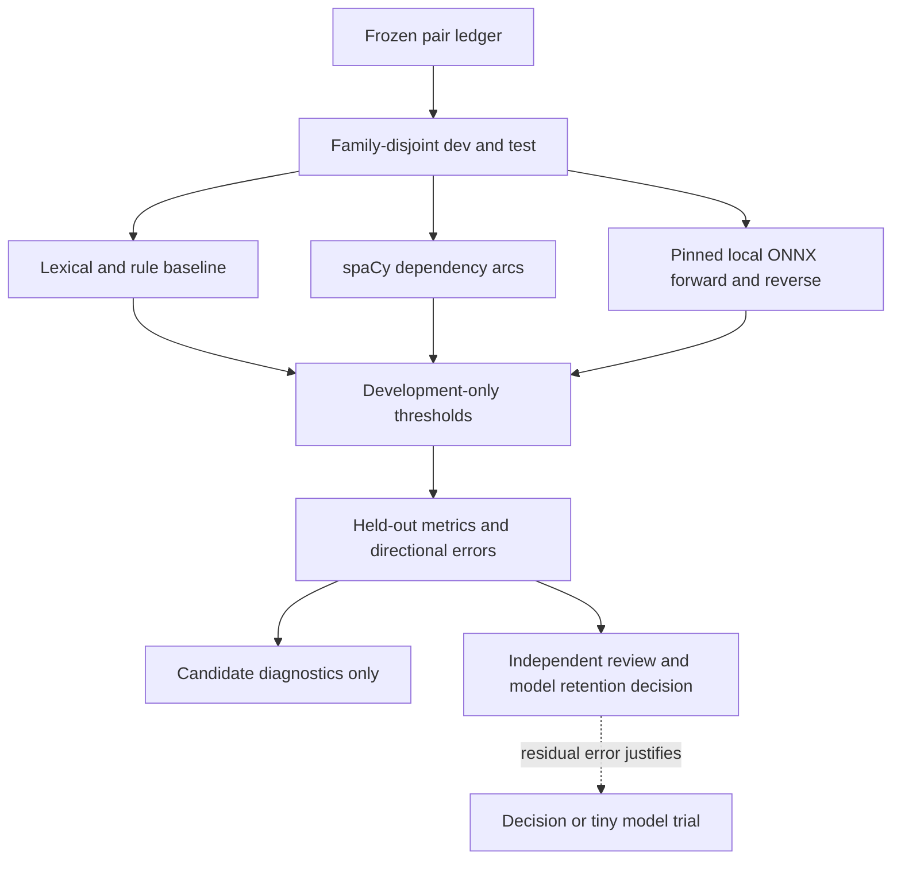
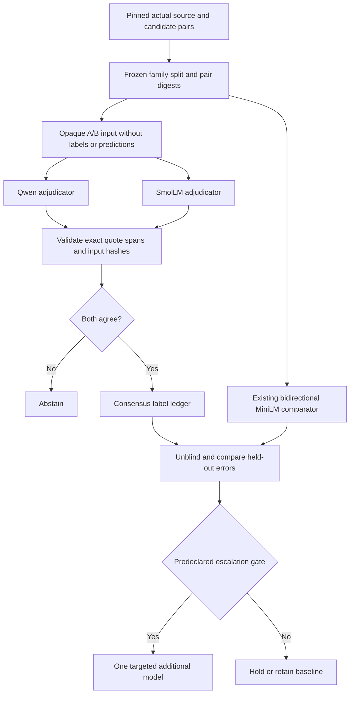

# Semantic reconciliation qualification (T01.5d–g)

## MoSCoW and evidence boundary

- **Must:** separate guideline families between development and held-out evaluation; preserve source fingerprints, both NLI directions, contradiction and neutrality; calibrate only on development cases; record false acceptance, false holds, coverage, per-family outcomes, runtime and exact model hashes.
- **Must:** candidate-only recommendations, never rights, methodological review, or canonical admission. Missing model/labels/overlong pairs are held, not truncated or interpreted as agreement.
- **Should:** compare lexical, classical marker, dependency-only and combined classical/dependency scores against bidirectional NLI using the same frozen cases. Evaluate paired errors and uncertainty on independently labelled actual guideline families before selecting a production method.
- **Could:** benchmark a decision model or tiny generative model only when held-out evidence identifies a residual error that such a model could plausibly resolve. Verify exact licence, artifact/runtime compatibility, structured output, and source-span accuracy first.
- **Won't:** download models in routine regression CI or execute remote model code; introduce a service, vector store or auto-approve any candidate.



## First experiment

Thirty-six original synthetic pairs (12 dev, 24 held-out): PRISMA and CHEERS
dev; CONSORT, STARD, ARRIVE and TRIPOD held-out. Exact, active/passive,
conjunction removal, numerical changes, negation, unrelated and reverse
implication. These are analyst-authored labels frozen before execution,
**not independent clinical/methodological adjudication or real guideline pairs**.
No verbatim guideline text added.

Fixed model: [cross-encoder/nli-MiniLM2-L6-H768](https://huggingface.co/cross-encoder/nli-MiniLM2-L6-H768)
revision c847a3c0e1cad93a5343183ef183f3044e3fc7c2; Apache-2.0; quantised
ONNX AVX2 file SHA-256 44391a5241a62e0083c1a8899a71e69a092b95aea5ba89e14062925468eceac7.
Official config label order contradiction/entailment/neutral. No remote code,
no Hugging Face inference. Hosted CPU runs explicitly when experimental inputs
change or manually dispatched. spaCy en_core_web_sm 3.8.0 is a reference
pipeline; record exact installed versions and CPU. Do not infer training
independence of external model from our family split.

Predeclared threshold grid .5/.6/.7/.8/.9/.95/.99/1.01. Select max dev true
accepts at zero dev false accepts, break ties at higher threshold. 1.01 is
abstain-all. Test metrics are descriptive for this tiny curated benchmark
and not production operating thresholds. NLI scores must have finite
probabilities in both directions, both top labels entailment; report the full
directional confusion. Exact surface agreement remains separately reported.

## Independent actual-source qualification — blinded model subagents

No human labelling or adjudication is required for this benchmark. Use two
stateless model-agent processes with distinct pinned Apache-2.0 GGUF weights
(Qwen2.5-1.5B-Instruct and SmolLM2-1.7B-Instruct), neither the MiniLM comparator.
Freeze the family-disjoint actual-source and candidate pair ledger before
inference. Give each agent only opaque ID and A/B text; hide guideline-family
split, constructed control class, other votes, and algorithmic predictions.
Use independently generated structured five-class judgements and exact unique
supporting spans. Invalid, missing, or conflicting votes abstain. Never
fabricate a third adjudication or equate agreement with ground truth.

Source-derived controls cover equivalent, additional obligation (narrower),
weakened obligation (broader), negation (contradictory), and different
requirements (indeterminate); the agents independently assess the actual
relationship rather than receive those intended classes. Keep real legacy
discrepancies separate from constructed controls. Reuse exact source and
table pins; unavailable or changed sources stay held. No source text, agent
quotes, or private pair files in public artifacts. Record model revisions,
weight hashes, prompts, input digests, span offsets, runtime, coverage and
per-class agreement and errors. PRISMA is development; CHEERS, CONSORT and
TRIPOD are held out when their exact source pins can be replayed.

Escalation gate predeclared: at least ten held-out consensus pairs, at least
two held-out families and 50% agreement coverage; at least two false
equivalences or two errors within a class with at least three consensus
examples. Only then evaluate one targeted additional NLI or decision model.
If insufficient agreement, report an adjudication deficit, not a comparator
accuracy claim. Small models are fallible and may share training biases.
The benchmark is automated candidate evidence, not rights, methodological
authority, or canonical admission. Existing external admission gates remain
distinct.



Four isolated RED/GREEN tests passed for blinding, span validity,
directionality and escalation gating. Actual model-agent and real-source
execution must be established by its hosted receipt; this plan is not a
claim of completed adjudication.

## Reproduction

```sh
python -m unittest tests.test_semantic_benchmark -v
python -m scripts.semantic_benchmark --cases contracts/examples/semantic-reconciliation-synthetic-v1.json --assets /path/to/pinned-assets --output /tmp/semantic-receipt.json --revision "$(git rev-parse HEAD)"
```

Three isolated RED/GREEN tests of the deterministic scoring/split core passed
locally. Full code and actual model/dep execution require hosted artifacts.
No decision/tiny-model benchmark is justified before seeing residual held-out
errors. The user requested a benchmark, not admission. Track 05 remains the
independent qualification owner. #111/#95/#82; depends on #150.
