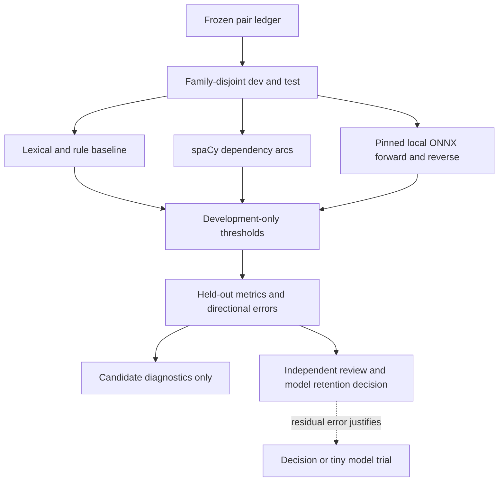

# Semantic reconciliation qualification (T01.5d–g)

## MoSCoW and evidence boundary

- **Must:** separate guideline families between development and held-out evaluation; preserve source fingerprints, both NLI directions, contradiction and neutrality; calibrate only on development cases; record false acceptance, false holds, coverage, per-family outcomes, runtime and exact model hashes.
- **Must:** candidate-only recommendations, never rights, methodological review, or canonical admission. Missing model/labels/overlong pairs are held, not truncated or interpreted as agreement.
- **Should:** compare lexical, classical marker, dependency-only and combined classical/dependency scores against bidirectional NLI using the same frozen cases. Evaluate paired errors and uncertainty on independently labelled actual guideline families before selecting a production method.
- **Could:** benchmark a decision model or tiny generative model only when held-out evidence identifies a residual error that such a model could plausibly resolve. Verify exact licence, artifact/runtime compatibility, structured output, and source-span accuracy first.
- **Won't:** download models in routine regression CI or execute remote model code; introduce a service, vector store or auto-approve any candidate.



## First experiment

Thirty-six original synthetic pairs (12 dev, 24 held-out): PRISMA and CHEERS
dev; CONSORT, STARD, ARRIVE and TRIPOD held-out. Exact, active/passive,
conjunction removal, numerical changes, negation, unrelated and reverse
implication. These are analyst-authored labels frozen before execution,
**not independent clinical/methodological adjudication or real guideline pairs**.
No verbatim guideline text added.

Fixed model: [cross-encoder/nli-MiniLM2-L6-H768](https://huggingface.co/cross-encoder/nli-MiniLM2-L6-H768)
revision c847a3c0e1cad93a5343183ef183f3044e3fc7c2; Apache-2.0; quantised
ONNX AVX2 file SHA-256 44391a5241a62e0083c1a8899a71e69a092b95aea5ba89e14062925468eceac7.
Official config label order contradiction/entailment/neutral. No remote code,
no Hugging Face inference. Hosted CPU runs explicitly when experimental inputs
change or manually dispatched. spaCy en_core_web_sm 3.8.0 is a reference
pipeline; record exact installed versions and CPU. Do not infer training
independence of external model from our family split.

Predeclared threshold grid .5/.6/.7/.8/.9/.95/.99/1.01. Select max dev true
accepts at zero dev false accepts, break ties at higher threshold. 1.01 is
abstain-all. Test metrics are descriptive for this tiny curated benchmark
and not production operating thresholds. NLI scores must have finite
probabilities in both directions, both top labels entailment; report the full
directional confusion. Exact surface agreement remains separately reported.

## Independent actual-source qualification

Use existing retained source/legacy item ledger and canonical PRISMA positive
control. An assessor independent of implementation must label both implications
and error categories (negation, obligation, scope, quantifier, condition,
applicability, argument roles, structure). Two reviewers independently label
a stratified family-level sample of candidate matches and discrepancies;
adjudicate disagreement before unblinding predictions. Keep source edition,
SHA-256, printed IDs, anchor, candidate digest and rationale; do not export
rights-unclear text. Include a distinct held-out family not used to tune
rules. Report paired errors and binomial intervals, not a universal accuracy
claim. No actual independently adjudicated label ledger exists yet.

## Reproduction

```sh
python -m unittest tests.test_semantic_benchmark -v
python -m scripts.semantic_benchmark --cases contracts/examples/semantic-reconciliation-synthetic-v1.json --assets /path/to/pinned-assets --output /tmp/semantic-receipt.json --revision "$(git rev-parse HEAD)"
```

Three isolated RED/GREEN tests of the deterministic scoring/split core passed
locally. Full code and actual model/dep execution require hosted artifacts.
No decision/tiny-model benchmark is justified before seeing residual held-out
errors. The user requested a benchmark, not admission. Track 05 remains the
independent qualification owner. #111/#95/#82; depends on #150.
