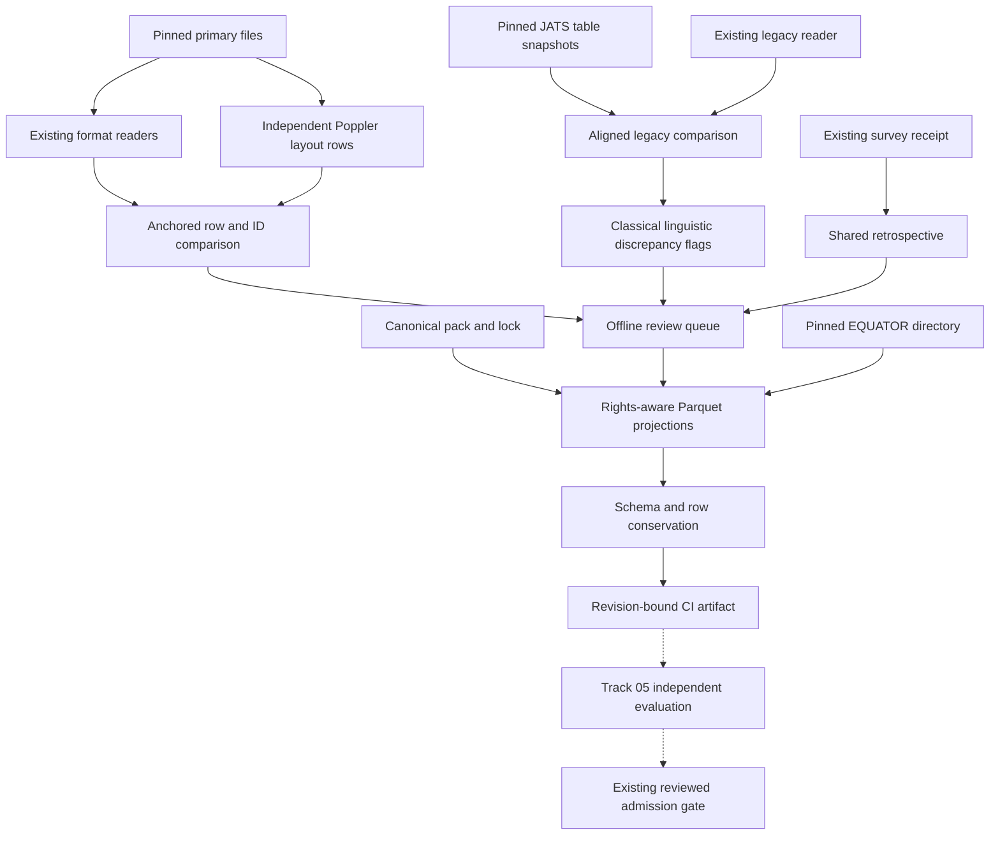
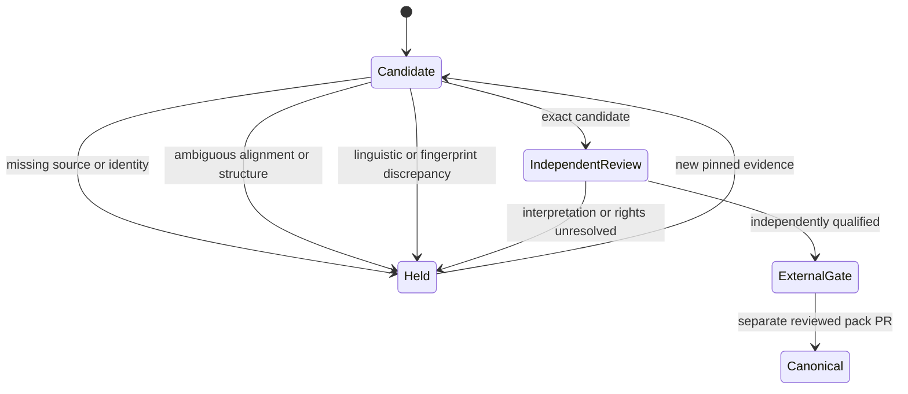

# Source reconciliation and analytical projections

Track 01 T01.5c/d/h; #111, #95, #82, #120. Track 05 owns independent
qualification; Track 04 owns pinned downstream consumption. Acquisition/resume
remains in #142; do not duplicate the provider or receipt pipeline.

## Requirements (MoSCoW)

| ID | Priority | Requirement | Acceptance |
| --- | --- | --- | --- |
| SR-01 | Must | Use exact source bytes and two independent PDF engines | Compare full rows by unique printed ID, normalized digest, order, and native/Poppler anchors; unresolved geometry is held |
| SR-02 | Must | Keep identifier-only evidence distinct from full text | Missing headers, duplicate IDs, score columns, wrapped/invalid cells and missing rows tested |
| SR-03 | Must | Detect classical linguistic discrepancies | Synthetic negation, modality, quantifiers, conjunctions, conditions, temporal and lexical changes; no nonexact pair called equivalent |
| SR-04 | Must | Run unattended on pinned local inputs | CI runs without model download or fresh source acquisition; explicit held outcomes and deterministic review sampling |
| SR-05 | Must | No automatic source or rights admission | Zero new canonical packs, no writes to pack/source trees; candidate output contains fingerprints rather than prose |
| SR-06 | Must | Generate typed Parquet analytical views | Explicit nullable Arrow-compatible schema; Zstandard; unique keys, referential integrity, full readback conservation and revision-bound manifest |
| SR-07 | Must | Preserve existing canonical authority and effective rights | Canonical projection may carry text only for rights-cleared items; no unreviewed candidate text |
| SR-08 | Should | Generalize pairwise comparison across representations | EcoEvo item-level missing/ambiguous/different/equal diagnostic rows; later independent families |
| SR-09 | Should | Integrate acquisition receipt review without a new crawler | Optional existing survey receipt, shared retrospective; scheduled producer #142 separately qualified |
| SR-10 | Should | Independently evaluate performance | Held-out guideline-family split; anchored precision/recall, false acceptance and abstention; exact revisions and parser versions |
| SR-11 | Could | Add linguistic dependency parsing or statistical NLI | Only if held-out residual errors justify model/runtime cost |
| SR-12 | Won't (this increment) | Model-based or majority-vote admission; new service or vector index | No inference service, automatic approval, or replacement of canonical JSON |

## Design





The offline comparator implements marker/context diagnostics, not a POS or
dependency parser. It does not establish semantic equivalence. Poppler
reconstructs conservative explicit one-line column headers and unambiguous
continuations. Unsupported geometry is held; whole-corpus PDF and HTML
qualification remains open. Retained JATS and source candidate rows are not
canonical packs. The deterministic 10% review sample (at least one exact
candidate per edition) is a worklist, not an estimate of false acceptance.

## Data contract and dependency

One optional export dependency: Polars, pinned for Python test/export CI
(MIT, including its native runtime package). Owner Track 01; no Rust linkage.
Remove the export invocation and dependency to roll back, retaining existing
JSON receipts. Typed tables: guidelines, sources, requirements, source anchors,
canonical requirements (effective-cleared text, licence, attribution and change notice), comparisons, format
comparisons, extraction runs, and admission decisions. Keys are scoped to
source/edition and row ordinal; printed IDs remain separate. Null indicates
unavailable evidence rather than zero. No raw candidate text is exported.
The manifest includes revision, inputs, table schema, row count, and SHA-256.
Parquet is a generated analytical view, not an editable source. Retain in the
existing Python coverage artifact; do not commit generated binaries.

## Reproduction and remaining gates

```sh
python -m pip install -r requirements/python-tests.txt
python -m unittest tests.test_source_reconciliation tests.test_compare_ecoevo_formats -v
python -m scripts.probe_legacy_source_text --output /tmp/triage.json
python -m scripts.compare_ecoevo_formats --root . --report /tmp/triage.json --output /tmp/ecoevo.json
python -m scripts.source_reconciliation --ecoevo /tmp/ecoevo.json --output /tmp/source-projections --revision "$(git rev-parse HEAD)"
```

The first six isolated tests passed with exact module/test blobs at
1efeb2798685ea8250e22e5b250be3f922bd2902, and an additional actual synthetic
PDF Poppler replay returned one correctly fingerprinted row. This is not full
repository acceptance. The Parquet dependency is unavailable in the isolated
local environment; the existing hosted CI must execute the round-trip and
retained-source artifact. Inspect the exact-head evidence and receiving-main
receipt before closing any track. Keep older failed/incomplete receipts intact.

The extended isolated module/tests at `7a591b9648d34f806bef90d15d8109e389b73d48` matched the local Git blobs: eight tests passed, one Parquet test skipped because Polars was absent. A separate locally generated ruled PDF was extracted independently by pdfplumber 0.11.9 and Poppler: one complete row matched. Hosted Repository health run 45383591230 failed downloading the pinned ALint executable (HTTP 500 on three attempts), not a lint finding. Preserve that failed receipt and requalify the new head. Final extended CLI and Parquet tests require hosted execution.

## Hosted replay and independent review (24 November 2026)

At candidate head `051980593145107f815eeaea32ebde3317bcba8d`, synthetic merge revision `81eac9a3cc7146a3e122074557e4c8802a23b9ea`, [Assurance](https://github.com/edithatogo/standards_check/actions/runs/45383864747) passed with **403 Python tests, zero skips**. The downloaded [artifact 14914883717](https://github.com/edithatogo/standards_check/actions/runs/45383864747/artifacts/14914883717) SHA-256 `f3c4bdd4d862727c6896dc6f2ffa5996f14041728f60d752fd958a9c65201fed` matches the hosted digest. All nine Parquet files' SHA-256s matched their manifest; file magic checked locally, typed round-trip ran in hosted CI (local Polars unavailable). Rows: guidelines 725, sources 729, requirements/anchors 391 each, canonical requirements 42, linguistic comparisons 82, format comparisons 890, extraction runs 9, dispositions 351 (268 independent review, 2 source holds, 28 text discrepancies, 53 unaligned). Zero promotions.

Official byte comparison SHA-256 `8528e6d7f7bc4f68e210f549c4feb97909ce3881b07038befec196e9075b171b`: PDF, DOCX and XLSX each byte-identical to official download; CSV is a local derivative. CSV/DOCX/XLSX 89/89 ordered IDs; DOCX/XLSX 89 exact; CSV versus either 88, discrepancy 8.3. PDF: pdfplumber 0 complete rows (incomplete/ambiguous header); Poppler 89 ID tokens but 0 complete rows (missing header). Thus T01.5c is **not qualified**. Original artifact remains immutable. The review identified a cross-page false completeness risk; two isolated tests using the exact old layout function failed RED, then passed with the proposed change GREEN. Hold every nonfinal-page tail lacking independently established row-boundary geometry, including when a header repeats. This deliberately sacrifices coverage; final full hosted tests required. Next: independent geometry-aware table reconstruction on the pinned actual PDF; do not infer row completeness from identifier recovery or compare against a legacy oracle.


## Reuse cross-format evidence across the pipeline

Implement through existing contracts/tracks rather than a second source
database. See the [manifestation benchmark](cross-family-format-benchmark.md)
and [specialist source gate](../../source-reconciliation/specialist-family-gates-20261126.md).
Maintain exact source identity and anchored clause fingerprints separately
from layout projection, scope, heading and note-link evidence. A complete
ordered row signature is a candidate content observation, never sufficient
for canonical or rights admission. Preserve path aliases and structural
holds, even when bytes or fingerprints agree. Where same source assets
occur across families, inspect provenance before grouping leakage components.

The weekly EQUATOR asset monitor identifies candidate changed paths;
requalify changed editions and compute exact ordered item/field differences
before touching canonical packs or progress. T03 owns reversible migration,
T04 owns downstream rendering/representation contracts, T05 owns
independent family-disjoint qualification. Test PDF/DOCX/HTML/XML and
native Typst/LaTeX round trips against the same item/anchor references;
do not treat generated renderings as additional independent examples.
Use measured structural residuals and single-change negative controls,
including scope and note-link loss, to choose further readers/models.
Preserve public redistribution and research-use decisions separately.

Use #191 bibliographic evidence, #193 catalogue topic/ontology candidates,
#181 native-format qualification and #192 durable publication supplement.
They retain their current owners; the source lane supplies verified
manifestations and anchor evidence only. No parallel pipeline, duplicated
model execution or new registry. Retain independent reference lock and
confirmatory factorial acceptance under T01.052/T05.049/T05.063.
