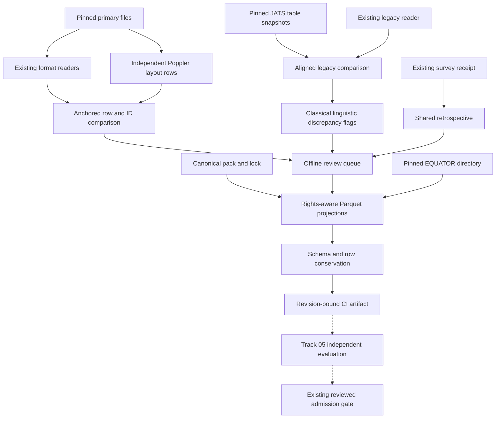
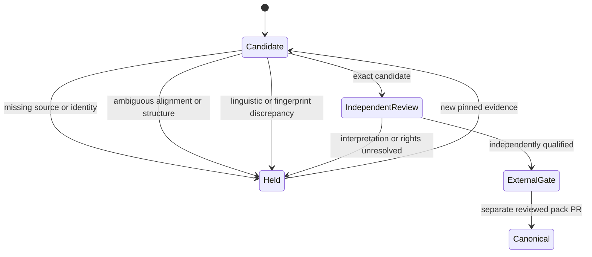

# Source reconciliation and analytical projections

Track 01 T01.5c/d/h; #111, #95, #82, #120. Track 05 owns independent
qualification; Track 04 owns pinned downstream consumption. Acquisition/resume
remains in #142; do not duplicate the provider or receipt pipeline.

## Requirements (MoSCoW)

| ID | Priority | Requirement | Acceptance |
| --- | --- | --- | --- |
| SR-01 | Must | Use exact source bytes and two independent PDF engines | Compare full rows by unique printed ID, normalized digest, order, and native/Poppler anchors; unresolved geometry is held |
| SR-02 | Must | Keep identifier-only evidence distinct from full text | Missing headers, duplicate IDs, score columns, wrapped/invalid cells and missing rows tested |
| SR-03 | Must | Detect classical linguistic discrepancies | Synthetic negation, modality, quantifiers, conjunctions, conditions, temporal and lexical changes; no nonexact pair called equivalent |
| SR-04 | Must | Run unattended on pinned local inputs | CI runs without model download or fresh source acquisition; explicit held outcomes and deterministic review sampling |
| SR-05 | Must | No automatic source or rights admission | Zero new canonical packs, no writes to pack/source trees; candidate output contains fingerprints rather than prose |
| SR-06 | Must | Generate typed Parquet analytical views | Explicit nullable Arrow-compatible schema; Zstandard; unique keys, referential integrity, full readback conservation and revision-bound manifest |
| SR-07 | Must | Preserve existing canonical authority and effective rights | Canonical projection may carry text only for rights-cleared items; no unreviewed candidate text |
| SR-08 | Should | Generalize pairwise comparison across representations | EcoEvo item-level missing/ambiguous/different/equal diagnostic rows; later independent families |
| SR-09 | Should | Integrate acquisition receipt review without a new crawler | Optional existing survey receipt, shared retrospective; scheduled producer #142 separately qualified |
| SR-10 | Should | Independently evaluate performance | Held-out guideline-family split; anchored precision/recall, false acceptance and abstention; exact revisions and parser versions |
| SR-11 | Could | Add linguistic dependency parsing or statistical NLI | Only if held-out residual errors justify model/runtime cost |
| SR-12 | Won't (this increment) | Model-based or majority-vote admission; new service or vector index | No inference service, automatic approval, or replacement of canonical JSON |

## Design





The offline comparator implements marker/context diagnostics, not a POS or
dependency parser. It does not establish semantic equivalence. Poppler
reconstructs conservative explicit one-line column headers and unambiguous
continuations. Unsupported geometry is held; whole-corpus PDF and HTML
qualification remains open. Retained JATS and source candidate rows are not
canonical packs. The deterministic 10% review sample (at least one exact
candidate per edition) is a worklist, not an estimate of false acceptance.

## Data contract and dependency

One optional export dependency: Polars, pinned for Python test/export CI
(MIT, including its native runtime package). Owner Track 01; no Rust linkage.
Remove the export invocation and dependency to roll back, retaining existing
JSON receipts. Typed tables: guidelines, sources, requirements, source anchors,
canonical requirements (effective-cleared text only), comparisons, format
comparisons, extraction runs, and admission decisions. Keys are scoped to
source/edition and row ordinal; printed IDs remain separate. Null indicates
unavailable evidence rather than zero. No raw candidate text is exported.
The manifest includes revision, inputs, table schema, row count, and SHA-256.
Parquet is a generated analytical view, not an editable source. Retain in the
existing Python coverage artifact; do not commit generated binaries.

## Reproduction and remaining gates

```sh
python -m pip install -r requirements/python-tests.txt
python -m unittest tests.test_source_reconciliation tests.test_compare_ecoevo_formats -v
python -m scripts.probe_legacy_source_text --output /tmp/triage.json
python -m scripts.compare_ecoevo_formats --root . --report /tmp/triage.json --output /tmp/ecoevo.json
python -m scripts.source_reconciliation --ecoevo /tmp/ecoevo.json --output /tmp/source-projections --revision "$(git rev-parse HEAD)"
```

The first six isolated tests passed with exact module/test blobs at
1efeb2798685ea8250e22e5b250be3f922bd2902, and an additional actual synthetic
PDF Poppler replay returned one correctly fingerprinted row. This is not full
repository acceptance. The Parquet dependency is unavailable in the isolated
local environment; the existing hosted CI must execute the round-trip and
retained-source artifact. Inspect the exact-head evidence and receiving-main
receipt before closing any track. Keep older failed/incomplete receipts intact.
