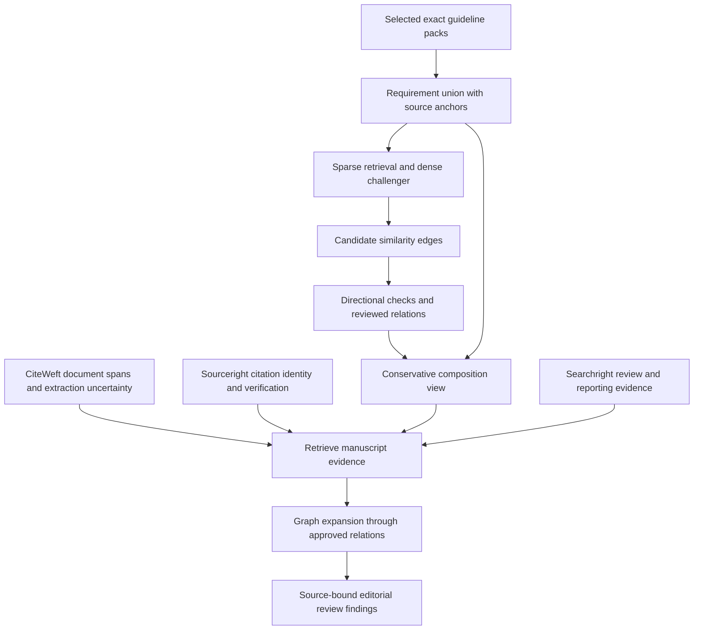

# Composed reporting checklists and an evidence-bearing requirement graph

**Status:** first bounded candidate preview; not a new reporting standard, an approved
merged checklist, or manuscript assessment. Owners: Track 01 and Track 04,
[#82](https://github.com/edithatogo/standards_check/issues/82),
[#149](https://github.com/edithatogo/standards_check/issues/149),
[#158](https://github.com/edithatogo/standards_check/issues/158) and
[#161](https://github.com/edithatogo/standards_check/issues/161).

## User workflow and invariants

Select exact editions of all potentially applicable guidelines, establish the manuscript's
study design, report type, interventions, methods and conditional applicability, and form
the union of obligations. Preserve the source pack, item ID, order, anchor, rights, and
evidence expectation. An unknown applicability decision remains unknown; it is never
silently dropped. Do not combine protocol, conduct or risk-of-bias judgements into a
reporting-compliance percentage.

A display group is not a replacement for its member requirements. Deduplicate repeat
selection of the identical pack and present likely overlaps for review. Only an accepted
bidirectional implication in the same explicit applicability universe can support a
semantic display group, and the original member IDs and receipts remain addressable.
A narrower requirement can cover a broader one only where the implication, applicability,
and actual manuscript evidence are established. Otherwise both remain. Contradictions
and unresolved scope become review tasks. Do not take connected components of
similarity edges as equivalence classes, or let a high score remove requirements.

For example, reporting all prespecified outcomes and reporting at least one outcome
are related but not interchangeable. An explicit condition or negation can reverse a
meaning even where a lexical or embedding score is high. Record coverage of every
selected requirement; compression is secondary to conservation and false-merge risk.

## Bounded first implementation

`python -m scripts.compose_checklists --pack <pack.json> --pack <other-pack.json> --top-k 5`
reads explicit local JSON inputs and writes an advisory JSON preview to stdout. Use the
existing pack schema validator and lexical normalization. The input objects are not
authenticated by schema validation; verify actual source, pack locks and rights separately.
Every distinct requirement survives. Only the identical repeated pack selection is
deduplicated; conflicting identities fail. The source-reconciled or externally validated
reporting/protocol pack and effective item rights must both be cleared before a normalized
requirement contributes to term frequencies. Imported, held or token-empty requirements
retain their identities but have no search vectors. The output is a local preview, not a
rights-cleared dataset; it contains source identities, content hashes, ordinal, source
anchor, held status and directed top-k candidate scores, not source prose or vectors.
A score of one is not a verified equivalent relation. The chosen pack set determines IDF;
scores from distinct snapshots are not directly comparable.

The deterministic baseline uses NFKC/casefold word unigrams and adjacent bigrams, raw term
frequency, smooth IDF `log((1+N)/(1+df))+1`, L2 normalization and cosine similarity.
Do not remove negation, numbers or modality through stop-word filters. Punctuation and
word order beyond adjacent pairs remain limitations. Retain positive, ranked cross-pack
candidates only; no arbitrary semantic acceptance threshold. Ties are stable by
pack/version/item identity. A local run is bounded to 1,000 selected requirements, 8,192
normalized characters per indexed requirement, 4 MB per input file and top-k 1–20.
Exhaustive sparse comparison is appropriate for this first scale, not a catalogue-wide
production index. No new runtime dependency, graph database, vector service or model
download. The only currently source-reconciled admitted pack is PRISMA 2020; cross-pack
qualification must first use synthetic or independently rights-cleared source material.

## Evaluation and scale-up

| Stage | Implementation decision | Evidence needed |
| --- | --- | --- |
| A: lexical retrieval | Current exact/fingerprint and TF-IDF baseline; compare BM25, word/character n-grams only when useful | Recall@k, precision@k, MRR/nDCG, candidate-pair reduction and review time; held and unmatched denominators |
| B: dense retrieval | Add one exact-pinned small multilingual or domain-relevant embedding challenger in the existing isolated experimental lane; compare against A and a sparse+dense rank fusion | Same frozen family/edition partitions, identical candidate budget, cost, throughput, licence and training overlap review |
| C: directional verification | Reuse existing classical scope diagnostics, bidirectional NLI and optional d1-2B complementarity, followed by independent anchored adjudication | Five-class outcomes, false-equivalence risk, abstentions, direction reversal, counterexamples, coverage; never admit by similarity |
| D: composition view | Reviewed equivalence display groups, explicit implication/coverage edges, original member IDs, applicability and unresolved conflicts | Item conservation, order invariance, idempotence, no unjustified group closure, manuscript evidence mapping and user review |
| E: graph analysis | Derive nodes/edges from existing Parquet evidence; use a sparse edge list and existing NetworkX only after measured need | Cross-family overlap, degree, communities, edition drift, reviewed-vs-candidate edges, unmatched and rights-held nodes; no popularity-as-importance |
| F: consumer evaluation | Add a read-only hybrid graph retrieval adapter after exact contracts are pinned | Citation/source-span fidelity, unsupported assertion rate, abstention, material editorial findings per reviewer hour, comparator and receiving canary |

Keep retrieval evaluation distinct from the existing five-class interpretation experiment.
Use the existing publication programme and append-only run/claim receipts; do not create
a second protocol registry. Freeze naturally occurring cross-family pairs and synthetic
negation, scope, quantifier, temporal and conditional controls before tuning. Split by
family/edition, not random paraphrases of the same obligation. Reference adjudication
must not see the retrieval scores. Report null and failed results. Compare one challenger
at a time and promote only on the predeclared risk/utility criteria. A graph community
is a thematic hypothesis, not semantic equivalence or official guidance. The first
local fixture tests are implementation evidence only, not domain retrieval accuracy.

## Hybrid graph retrieval for editorial assessment



Use lexical and dense retrieval for candidate generation and a bounded expansion through
approved, applicability-compatible requirement edges for evidence retrieval. Keep
similarity, extends/use-with/supersedes, equivalence, broader/narrower, contradiction,
document evidence and citation support as different edge types. Every node and edge
has producer revision, input snapshot, source anchor, authority, review status and
limitations. Preserve access controls for both standards and manuscript content.
Generate only source-supported candidate findings with exact manuscript spans, an
explicit reporting-item identity, evidence status, counterevidence and abstention.
A missing span is not proof of non-reporting, and reporting completeness is not
methodological validity, citation truth or misconduct. Never send private manuscripts
or rights-unclear standard text to external models without permission.

[CiteWeft](https://github.com/edithatogo/citeweft) owns neutral document extraction,
layout/spans, ambiguity and backend evidence; do not implement another extractor.
[Sourceright](https://github.com/edithatogo/sourceright) owns CSL, reference reconciliation
and provider/citation evidence; do not infer claim truth or duplicate its graph.
[Searchright](https://github.com/edithatogo/searchright) owns search, screening and
review flow evidence. StandardFlow owns standards identity, applicability, composition
and reporting-assessment decisions. The current ecosystem-evidence v1 schema has no
CiteWeft producer; qualify a versioned optional leaf adapter or consume a pinned neutral
document contract after checking exact revisions, without silently modifying v1.
Graph/vector artifacts are derived, separately rights-reviewed and version-pinned;
reuse Parquet, existing source projections, the selective dissemination gate and
receiving consumer tests. No graph database, persistent vector store, external model
service or Hugging Face upload until measured volume, consumer need and rights warrant it.

## Local and hosted evidence

The initial focused test file was executed before the module existed (collection failed
as expected), then against the new module in an isolated CPython 3.13.5 environment
with the copied pack schema semantics and validation entrypoint, not a full checkout.
Ten synthetic cases passed. The full repository's CPython 3.12, protected CI and
receiving-main qualification remain separate. Do not claim empirical semantic accuracy,
actual cross-checklist reduction or a deployed consumer. Preserve the original source
and all unverified nodes.


## Second bounded increment: statistical comparison and local display grouping

The word unigram/bigram TF-IDF baseline remains the default. Select
`--method char` to use normalized, boundary-padded character trigrams with
the same smoothed IDF, cosine scoring and eligibility rules. Both methods
preserve every original requirement and return candidate edges, not equivalence.
The pack snapshot digest is independent of ranking method.

```sh
python -m scripts.compose_checklists --pack a.json --pack b.json --method word --top-k 5
python -m scripts.compose_checklists --pack a.json --pack b.json --method char --top-k 5
python -m scripts.compose_checklists --pack a.json --pack b.json --group-review review.json
```

The optional local review input supplies `pack_snapshot_sha256`,
`scope_sha256` and `groups`. Each group contains `members` (exact
pack/version/item triples) and `pairs`. Each unordered pair must explicitly
declare `left`, `right`, `relation: equivalent` and a
`receipt_sha256`. Groups are disjoint and cross-pack; held or unknown items,
stale snapshots, missing or duplicate pairs, and non-equivalent relations
are rejected. All ungrouped items remain singleton rows. A three-item group
requires three pair reviews, not merely two adjacent similarity edges.
The result contains the unchanged requirement and candidate lists plus a
display partition. Scope and receipt hashes are **local declarations**:
the preview does not retrieve or authenticate the evidence or determine
applicability, and never promotes the declaration to an approved graph edge
or reports a semantic merge. A verified relation contract and an independently
reviewed study-specific scope are prerequisites for publishing or using a
group as an authoritative reporting decision.

### Synthetic development comparison (26 November 2026)

Six analyst-authored queries, twelve candidate requirements (six intended
targets and six contrast cases), same two-pack input and exhaustive positive
cross-pack rankings. Snapshot
`8c431e4c3e55a56446e610a445e3da5780026b77263cfacbeb5c8f3a2d8026e3`.
The panel in `tests/test_composition_extension.py` is a reproducible
development control, not a held-out or independently adjudicated benchmark.

| Method | Target ranks | Recall@1 | Recall@3 | MRR |
| --- | --- | ---: | ---: | ---: |
| Word unigram/bigram TF-IDF | 1, 1, 7, 8, 1, 2 | 3/6 | 4/6 | 0.628 |
| Character trigram TF-IDF | 1, 1, 2, 2, 1, 1 | 4/6 | 6/6 | 0.833 |

The character baseline retrieves more designed targets but still misranks
two at rank one. The test deliberately includes quantifier, omission and
scope contrasts. No automatic merges; no claim of natural-source or embedding
performance. Focused tests-first execution observed two expected failures
before implementation; 23 tests passed after implementation in an isolated
CPython 3.13.5 environment using the copied validator/schema semantics and
existing fixture helper. Hosted full-suite and receiving checks are separate.

### Next qualification

Freeze family/edition-disjoint natural queries and independently adjudicated
relations with a documented relevance definition, hard negatives and
uncertain cases. Compare both sparse methods and one locally executed pinned
dense bi-encoder against the same inputs, not a changing corpus. Measure
recall@k, precision@k, ranking quality, coverage/abstention, latency, memory,
index size and reviewer workload. Evaluate hybrid rank fusion as a separate
challenger, and directional equivalence independently of retrieval. Never
reuse the synthetic development panel as independent validation or adopt
transitive closure from similarity. Preserve producer revisions, scope and
rights; use the existing experiment and publication contracts. Do not add a
persistent vector database, graph service or model dependency until qualified
benefit and consumer need justify it.
