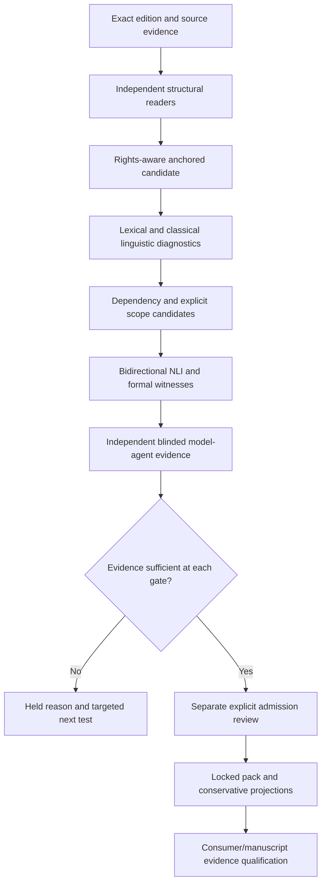

# Reporting guideline interoperability and assurance

Status: **proposed technical specification for discussion**, not an EQUATOR
standard, reporting guideline for a study type, legal permission, or accepted
scientific validation. The existing Canonical Standard Pack v1 JSON schema,
source manifest, lock and evidence contracts remain authoritative. This
document proposes a profile over them; it does not introduce another format.
Track 01 owns representation/source; Track 04 consumer exchange; Track 05
qualification. Issues #111, #118, #95, #82, #149, #30, #31, #116.

## Versioned technical specification

The normative proposal is now the immutable [profile 0.1.0](../specifications/reporting-guideline-representation/0.1.0.md),
tracked by the [version and approval registry](../../contracts/representation/releases.json).
It retains RGI-01–14 and defines directed relation semantics, applicability,
version compatibility and explicit approval receipts. Its status is **draft**;
there is no recorded specification approval or EQUATOR endorsement. This page
is the evolving architecture and evidence overview, not a second specification.
Run `python -m scripts.validate_representation_spec` to check snapshot integrity.

Existing executable foundations: [Canonical Standard Pack](CANONICAL_STANDARD_PACK.md),
[`standard-pack.v1.schema.json`](../../schemas/standard-pack.v1.schema.json),
[`source-manifest.v1.schema.json`](../../schemas/source-manifest.v1.schema.json),
[`standardflow-lock.v1.schema.json`](../../schemas/standardflow-lock.v1.schema.json),
[`ecosystem-evidence.v1.schema.json`](../../schemas/ecosystem-evidence.v1.schema.json).
The 42-item PRISMA pack is a bounded source-fidelity reference, not proof that
all proposed assertions pass. Profile obligations are proposals until mapped
to exact executable tests/receipts; use current validators rather than a
second validation framework.

## Independent triangulation and model escalation

Freeze the existing 33-pair development fixture; never tune it and call it
independent. Extend the existing benchmark with untouched guideline families,
edition/source-format strata and actual observed legacy discrepancies, not
only self-authored perturbations. Family split, anchor split and external model
training-set overlap are distinct. Use metamorphic tests (swap arguments and
A/B direction, voice, coordinated reordering, scope, numbers/units, conditional
exceptions), graph inverse/symmetry and applicability-aware consistency,
independent extraction, explicit counterexample witnesses, and exact small
truth sets. Expand to an SMT solver only if truth sets cannot represent
observed obligations; no speculative solver integration. A selected span must
support the claimed relationship, not merely be within bounds. Compare field
and five-class precision/recall, directional confusion, false equivalence,
material misses, abstention, coverage, calibration (Brier/log loss and
risk–coverage), per-family/format, paired changes and grouped uncertainty;
predeclare the primary endpoint and risk thresholds. No human benchmark
labelling required for the planned model-agent experiments; model-agent
consensus is not ground truth. External stakeholder review for a publishable
standard is a distinct activity.

Existing #155 owns model experiments, independent witness adjudication and
conditional DeBERTa comparison. No new parallel harness. Larger/better
task-trained encoders plausibly help but base checkpoints are not NLI
classifiers. Candidate shortlist, not installed or evaluated here:

| Model | Experiment and constraint |
| --- | --- |
| Existing MiniLM / DeBERTa-v3-xsmall | Preserve both CPU baselines and same frozen cohort; observed 12/20 and 18/20 on formal controls, not natural accuracy. |
| [cross-encoder/nli-deberta-v3-large](https://huggingface.co/cross-encoder/nli-deberta-v3-large) | First controlled size ablation using the same family and three labels; ONNX available, verify actual artifact and memory bound rather than lift limit generically. |
| [MoritzLaurer/DeBERTa-v3-large-mnli-fever-anli-ling-wanli](https://huggingface.co/MoritzLaurer/DeBERTa-v3-large-mnli-fever-anli-ling-wanli) | MIT, broader adversarial/domain NLI training; alternate training-data comparator. Label order entailment, neutral, contradiction differs from existing model. |
| [tasksource/ModernBERT-large-nli](https://huggingface.co/tasksource/ModernBERT-large-nli) | Apache-2.0, three-class multi-task NLI including logic/contract/scientific/temporal tasks; orthogonal architecture/training comparison. Configured context 2048, not base 8192. Training includes HANS/other public tasks, not independent on those tests. |
| [MoritzLaurer/ModernBERT-large-zeroshot-v2.0](https://huggingface.co/MoritzLaurer/ModernBERT-large-zeroshot-v2.0) | Binary entailment/not-entailment; useful directional screening but not a three-class drop-in or contradiction oracle. |
| [answerdotai/ModernBERT-large](https://huggingface.co/answerdotai/ModernBERT-large), [microsoft/deberta-v3-large](https://huggingface.co/microsoft/deberta-v3-large) | Base encoders only; skip fine-tuning absent sufficient independently qualified training/evaluation data. |
| [LiquidAI/d1-2B](https://huggingface.co/LiquidAI/d1-2B) | Conditional decision-model trial for typed implication questions, scope, abstention and source-span extraction. Publisher reports calibrated one-pass decisions, not this task accuracy; LFM Open License, custom-code/runtime and model integrity review before any execution. |

Only one additional challenger at a time, against the retained baseline
on the same independent pairs. Standalone superiority is not required:
predeclare incremental supported errors at a fixed review budget, shared misses,
spurious flags, harmful changed decisions, abstention, calibration and cost.
A second model is useful only if measured evidence supports that role;
architectural diversity alone does not establish independent errors. Prefer the existing ONNX CPU harness if exact
assets fit; use local GPU only when measured. Pin weights/config/tokenizer
and label mapping; prohibit silent truncation and remote model code. Treat
larger generative judges, document rerankers and extractive QA as separate
experiments: alignment recall, evidence sufficiency, structured obligations,
applicability, attribution and manuscript reporting; no universal score.
A decision model can output two directed implication decisions and
contradiction/satisfiability or abstention; deterministic mapping avoids
semantic class name inversion but does not establish truth. Do not benchmark
more models solely because a newer checkpoint exists.

## Historical programme receipt — 24 November 2026

Receiving main `30992df89f85c07ec7bb0d7187b438510456b2bc` after #154.
[Assurance](https://github.com/edithatogo/standards_check/actions/runs/45400651706)
and Canonical Pack, foundation, privacy, inventory, RepoHealth, Scorecard
passed; [Python artifact 14923461261](https://github.com/edithatogo/standards_check/actions/runs/45400651706/artifacts/14923461261)
ZIP SHA256 `6989f07ea8c6881bcd965f798aa9c1938207540aa892ff8e9bb28c81ebd8175c`
verified locally, commit.txt matches. 432 tests, 84.60% Python branch-inclusive
coverage. Same 33 development pairs: rules 18/2/6, dependency 24/8/0 TP/FP/FN,
zero promotions. Nine existing Polars Parquet files match their manifest
SHA256s; 725 guideline rows, 729 source rows, 569 requirement/anchor rows,
42 canonical requirements, 82 linguistic comparisons, 890 format comparisons,
9 extraction runs, 527 dispositions (446 independent review, 28 text
discrepancy, 53 unaligned). Rows are representation-scoped, not unique
verified items. Projection's catalogue remains the pinned 719-entry
revision and survey_sha256 is null; #142 should supply the existing
versioned producer receipt, not a separate database or new writer.

Latest inspected [catalogue artifact 14921587635](https://github.com/edithatogo/standards_check/actions/runs/45397665364/artifacts/14921587635)
ZIP SHA256 `813449ee0f755c4f059f27541dba6cd78e80df4fea5dba46c2365beb7c157910`,
source revision `d74413b15d266334067e1e5c104957601be3ba6c`: 720 published
records, one metadata issue; 315 with 912 original-link leads; 623 incomplete
lookups, 20 metadata-only, 77 missing identifiers, no new pack promotions.
SPIRIT 53/53 (structural hold), STARD 34/34 and TRIPOD+AI 52/52 numbered
rows observed; ARRIVE and CONSORT acquisition held, STROBE unsupported table.
Historical earlier census 136 OA XML candidates must not be discarded or
silently merged with incomplete new evidence. Resume #142 after exact
receiving-main sync, keep identity conflicts held. Four pinned article tables
82/82 replayed on #154, PRISMA Abstracts structural hold; #156 independent
EcoEvo 89/89 layout-normalized, strict fingerprints retained, CSV item 8.3
held. Exactly one current Canonical Standard Pack (PRISMA 2020, 42 source-
reconciled items; #82 interpretation/migration still open). Directory-wide
discovery is not 720 implemented checklists. No new canonical admissions
without source and rights receipts.

Operational assurance is substantial, not maximal. [Scorecard SARIF
14922663828](https://github.com/edithatogo/standards_check/actions/runs/45400651897/artifacts/14922663828)
verified ZIP hash `0d7bbed356e22ced911c6e294ccb74439fb5eec380eeec6cd521684fea86538c`:
14 unhashed pip-command warnings (one frozen legacy Dockerfile), native fuzzing
not recognised, human approval scoring not compatible with intentional solo
maintainer policy, no badge registration. Keep ruleset and no bypass; no
score-chasing. #146 locked native ASan fuzz qualification, #30 offline runner
still queued, #116 maintained hash-locked wheel closure, independent
accessibility/deployed browser tests #123, release SBOM/provenance/signing
and downstream canaries remain. #145 updated spaCy 3.8.11 to 3.8.18 but
the duplicate hard-coded runtime pin made [Python job](https://github.com/edithatogo/standards_check/actions/runs/45401055820/job/138469441267)
fail after 432 passing tests. Root-cause fix: derive the exact pin from the
existing installed requirement file, retain wheel digest, model version,
licence and actual runtime checks, rerun after updater sync. Isolated exact
baseline hash RED on simulated manifest update, GREEN after change; three
local tests and five subtests passed, 17 synthetic rule challenge replayed.
No trained 3.8.18 inference or full checkout local run claimed. Build
Documents [45400651928](https://github.com/edithatogo/standards_check/actions/runs/45400651928)
built successfully but deploy-pages twice could not find `github-pages-1`/`github-pages-2`
despite successful REST metadata verification; preserve both receipts,
investigate provider/API visibility via existing #123, no weakened artifact
binding or custom deployment substitute.

## Publication and external engagement

The executable publication plan is now the [protocol 0.1.0](../research/publication-protocol.v0.1.0.md),
[experiment/claim contract](../../contracts/publication/programme.v1.json) and
[publication-evidence skill](../../.agents/skills/publication-evidence/SKILL.md).
The initial contract is planned, with no experimental freeze, model execution
or observed scientific claim. Its validator checks integrity, not truth.

Publish as an RFC-style technical interoperability/assurance profile, with
synthetic fixtures, schemas, implementation reference, conformance tests,
source-rights boundary and versioning. Prior-art/gap review first: compare
existing checklist projects, EQUATOR toolkit, metadata standards and
computable guideline representations. Do not claim novelty or new study
reporting guideline without this review and community input. A methods
paper could quantify corpus coverage, format disagreements, rights holds,
classical/NLI/decision incremental benefit, independent validation, error
taxonomies and calibration. Freeze evaluation protocol before new held-out
results; release permitted fixtures and code, not unauthorized publisher
text. Use a software paper (e.g. JOSS) only after actual feature-complete
release, usability and open-development requirements. Consider a separate
methods manuscript and DOI-versioned technical profile; no submission yet.
EQUATOR's [guideline development toolkit](https://equator-network.org/toolkits/developing-a-reporting-guideline/index.html)
and [publication guidance](https://equator-network.org/toolkits/developing-a-reporting-guideline/writing-up-and-publishing-your-reporting-guideline.html)
apply if developing actual reporting recommendations, rather than this
representation profile. Related [#118](https://github.com/edithatogo/standards_check/issues/118)
has the prepared external issue; prior write attempt HTTP 403, upstream
permission read-only and no matching issue visible at audit. No claim of
contact or endorsement. Ask the network about metadata IDs, editions,
reuse policy and profile review through an authorized account; do not
request blanket permissions or an API.

References for interoperability: [DCAT 3](https://www.w3.org/TR/vocab-dcat/),
[PROV-O](https://www.w3.org/TR/prov-o/), [SKOS](https://www.w3.org/TR/skos-reference/),
[RO-Crate 1.2](https://www.researchobject.org/ro-crate/specification/1.2/introduction),
[HANS evaluation](https://aclanthology.org/P19-1334/),
[JOSS submission requirements](https://joss.readthedocs.io/en/latest/submitting.html).

## Ordered remaining delivery

Current execution and accepted/held integration are recorded in the
[representation programme receipt](../../conductor/tracks/01-canonical-standard-pack/representation-programme-20261124.md).
The sequence below is retained from the earlier receipt; #145 and #142 now
have later integration evidence. Preserve scientific and source gates.

1. Verify receiving revision of the runtime-pin fix and rerun #145 without
   dropping the exact-runtime gate; finish #146 and #30 with real receipts.
2. Resolve #142 source resume conflict; reuse #150 projection and integrate
   the survey snapshot, do not merge competing #151 writer merely to duplicate
   existing Polars output. Compare unique requirements/conservation tests,
   preserve useful ones and use one writer. #152/153 consolidate format
   extensions on #156, no reverting accepted geometry.
3. Complete current #155 witness experiment, actual model/coverage receipts
   and independent family gates. Keep current five-class criteria; above
   candidates are an evidence-led shortlist, not automatic implementation.
4. Qualify fresh source families, exact item-level rights/interpretations,
   and Searchright consumer canary; promote only through existing gates.
5. Seek authorized EQUATOR feedback, pilot the draft profile, independently
   assess release/accessibility and publish methods/software when warranted.

No additional runtime dependency, source content, canonical pack promotion,
accepted technical standard, external contact, or production model promotion
is created by this document.
