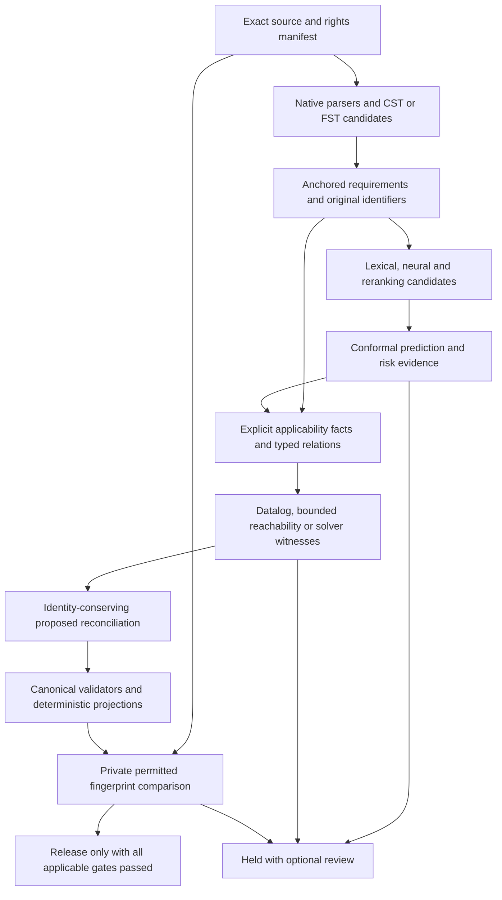

# Orthogonal statistical and formal assurance — 26 November 2026

Status: prospective extension and bounded synthetic implementation; not a frozen study,
normative representation amendment, scientific acceptance, rights determination or release.
Owners: Tracks 01 (semantic/source), 02 (artefacts), 03 (migration), 05 (assurance).
Reuse issues #82, #95, #149, #158, #116 and #31; no additional issue or dependency graph.
Baseline: main `341f5388bae99e7a5be9f7a29d04e2ed65b7f6dc`. PR #155 separately
holds specialist benchmarks and independent family qualification; its E9–E14 proposal is
not yet on main. Preserve E1–E8, that PR's scientific hold and the optional-review policy.

## Authority and routing

Neural output is advisory. Source identity, effective rights, applicability, semantic scope,
integer arithmetic, canonical locks and admission state are independently enforced. A held
case may be revisited by agents or humans; no mandatory human routine approval, no forced
decision. Independent reference evidence and actual authorization remain distinct obligations.
No solver, model or similarity threshold authorizes a new source or semantic equivalence.

## Stage map and decision ladder

| Method | First comparator and target | Escalate only for a measured residual gap |
| --- | --- | --- |
| Split and Mondrian conformal prediction | Dependency-free Python rank oracle; existing NLI scores; class-conditional strata | MAPIE as independent implementation comparator, risk control and grouped/selection-aware methods; Rust port after contract qualification |
| Datalog, ASP, SMT | Typed truth tables and existing Rust validation; datafrog/crepe for recursive joins | Clingo ASP for non-monotonic rules; Z3 for bounded implications, countermodels and conflicts |
| Global ontology alignment | Existing 106 identifiers, 31 domains, 26 records; typed edges; exact small constraint oracle | good_lp with HiGHS for ILP, Z3 or varisat for SAT/SMT feasibility; LogMap external reasoner comparator, not runtime |
| Concrete syntax trees and finite-state transducers | Native parser and generator; pulldown-cmark for Markdown events, typst-syntax for Typst; reversible explicit normalizers | tree-sitter language grammars and rustfst WFST only for measured coverage or ambiguity gaps |
| Leakage detection | Exact raw/normalized contiguous n-grams and containment, local rights-restricted reference | MinHash/SimHash candidate indexing only; probminhash or other licensed implementation if needed at catalogue scale |
| Differential and property-based fuzzing | Existing proptest, cargo-fuzz, Python parity harness and synthetic contracts | Stateful/generated adapters, solver/exhaustive finite oracle, targeted Bolero only if a test capability is missing |

Dependency shortlist is provisional, not a version or licence approval. Check exact
package, transitive licence, source, lock, maintenance, feature set, native build, cross-target
and offline reproducibility before admission; prefer MIT/Apache-2.0. good_lp's default solver
is not HiGHS: explicitly select the qualified backend. LogMap is LGPL-3.0, a comparator
only pending policy review. Keep model and native solvers out of ordinary runtime until
necessary. datafrog supports monotone Datalog evaluation; do not assume unrestricted
negation or ASP semantics. Petri nets with unbounded markings are not finite graphs.

## 1. Conformal statistical assurance

The local implementation `scripts/conformal_triage.py` consumes externally computed
true-label calibration nonconformity scores and a complete candidate-label score mapping.
Larger is less conforming. With n calibration observations, p = (1 + count of calibration
scores >= candidate score)/(n+1). Include if p > alpha; ties conservative; compare
integer basis points without rounding the rank boundary. Mondrian mode uses the
true-label stratum; missing/insufficient strata are explicitly reported. Empty, multiple
or under-resolved sets abstain; resolved singleton is advisory only. At alpha=.01,
n>=99 (per stratum when applicable) is only minimum attainable rank resolution,
not a power calculation. No model, runtime dependencies, calibration corpus or new admission
state. Use a typed five-class RGI-06 mapping in the caller; abstention is distinct from
indeterminate. Never silently omit missing true classes.

Under a fixed score function and exchangeability the guarantee is marginal label-set
miscoverage <= alpha (class-conditional for appropriately exchangeable Mondrian strata).
It is NOT a conditional-on-acceptance false equivalence, FPR, family-wide or joint guarantee.
Reranker scores rank relevance, not relation probabilities: calibrate their own retrieval
endpoint including missed gold candidates, not a five-way classifier from ranks alone.
Freeze score function, label orientation, model/weights/tokenizer, calibration and holdout
families, sampling unit, strata, tie treatment, candidate universe, alpha and
shift policy. Do not calibrate on synthetic or historically tuned controls; grouping
near-duplicate editions and within-family correlated items is essential. If a family is
the exchangeability unit, calibrate at that level or use an explicitly justified grouped
method. No claim for new domains without the assumptions or independent evaluation.
For false equivalence among accepted decisions, separately predefine denominator,
loss, risk-control/selection method and uncertainty; compare risk-coverage curves,
false-equivalence counts, FPR, reference coverage, abstention, cost and material errors.
Model-agent reference is not human consensus; do not pool reference types.
Compare implementation output to MAPIE or an independent exact rank oracle on frozen
synthetic and then eligible calibration data. Prospective E2/E3/E5 and proposed E11/E12
ablation, not a change to existing frozen design. Preserve all failures.

Development receipt: tests-first import failure, then six isolated Python 3.13.5
tests passed (including rank enumeration, ties, small and missing strata, empty/multiple
sets, malformed values); 43 statements and 18 branches, 100% local module coverage.
The tested source and test Git blob IDs are 18a9044d34923f50b97c2c0d4b5b37bf3726ffbd
and 54e722caa9c164e3556c8db73b42662e553eb1fd. Full checkout unavailable (DNS),
no Rust toolchain, no full repository CI acceptance, no empirical performance claim.
Use existing Assurance Python suite, not a separate mandatory workflow.

## 2. Symbolic applicability and reachability

Represent facts with typed, versioned, source-anchored identifiers, explicit true/false/
unknown and contradiction; no closed-world inference of nonapplicability from missing facts.
Rules distinguish report type, study design, population, intervention, jurisdiction, edition,
mandatory/recommended and extension precedence. Rule results retain source and derivation
witness; require proof of exclusion as well as inclusion. Unknown or inconsistent inputs
retain obligations, mark held and report counterexample/conflict. Multiple ASP stable models:
accept only skeptical conclusions common to all models, hold inconsistent/unknown results.
SMT/ILP timeout, infeasible, unknown, numerical ambiguity or equal optima must not silently
resolve decisions. Start with truth tables and small exhaustive oracle; qualify Datalog
only once recursive rule corpus exists. For PNML use actual places, transitions, multiplicity,
initial/final marking, guards where supported; test reachability, conservation, deadlocks,
dead transitions and bounded soundness separately. Enumerate bounded markings with limits;
unbounded or incomplete exploration is unknown, not proof. Existing diagram/PM4Py pipeline
is a comparator, not authority over typed Rust invariants. Retain witness/counterexample
and test contradictory, unknown, versioned and multiple-extension cases.

## 3. Globally consistent ontology/costing mapping

The 26 source records include context, methodology and historical records. Only five
instruments have 106 verified item/principle IDs; 31 domains, many-to-many editorial
covers_topic edges. A topic match is not equivalence; global one-to-one assignment would
destroy valid many-to-many mappings. Introduce typed candidate equivalence, narrower/broader,
covers_topic, conflict and no-match/unknown. Enforce one-to-one only in expressly
bijective identity scopes; retain jurisdiction, currency, price year, perspective, resource,
unit, modality and methods. A=A equivalence closure must respect explicit incompatibility;
strict hierarchy acyclic, not all graph cycles invalid. No transitivity over topical links.
ILP/Max-SAT chooses a feasible candidate subset with integer weights, explicit no-match,
hard constraints and soft evidence, deterministic tie handling or hold alternatives.
Verify emitted solution by independent exact checker; preserve infeasibility core,
objective, solver/version, constraints, optimality status and competing solutions.
Compare lexical/reranker-only, greedy, exact constrained and solver approaches against
independent typed reference and small enumerated optima; measure false merges, conflicts,
recall and constraint violations. Do not claim the seed is gold, or enforce a universal
one-to-one constraint. Probabilistic graphical models only as later evidence fusion if
independent data justify parameters; correlated model votes are not independent probabilities.

## 4. Lossless syntax and normalization

Prefer byte-preserving source spans plus explicit non-overlapping edits. A parser being
a CST does not guarantee lossless serialization; retain raw input and error nodes,
reject unsupported macros/constructs; verify untouched bytes, Unicode, whitespace,
comments, escaped text and source maps. pulldown-cmark is an event parser, not a lossless
CST. Keep canonical requirements and source order unchanged. Citation normalization may
identify a DOI or citation key, never invent one; retain original lexeme and authority
resolution, use existing SourceRight boundaries. Units use explicit reversible mappings
(e.g. UCUM where appropriate), exact conversion with dimensions and currency/price-year
semantics separately. WFSTs can encode ambiguity/cost and retain alternative paths;
deterministic tie/unknown handling, no paraphrasing, no expansion of arbitrary macros or
execution of untrusted document code. Test parse/emit round trips, idempotence, span and
semantic conservation; compare against existing Pandoc/native projections before adding
grammar packages or transducer runtime. E9/E13/E14 proposal and Track 02 projections.

## 5. Licensing leakage gate

Approximate MinHash estimates Jaccard similarity; it can miss a short copied clause
embedded in a long unrelated output. SimHash has different approximate distance.
Neither proves absence of copyrighted text. Use exact raw and Unicode-normalized
contiguous n-gram matching, per-source and per-output containment, and longest matching
runs; test near-copy across markup boundaries, Unicode, reordered clauses, short extracts
and permitted common phrases. Version normalization, n and thresholds; no arbitrary
claim of a legally safe token count. LSH may accelerate triage but never bypass the exact
restricted-corpus gate. At current corpus scale prefer exhaustive matching.
Scan final candidate pack text AND serialized Markdown/Typst/LaTeX, JSON/API, data
and rendered/exported text across fields/fragments; preserve provenance and explicit
per-source exceptions for authorized text. Missing reference, unavailable secure runner,
incomplete extraction, unknown rights or exceeded budget => hold release. Do not download,
commit, hash-publish or cache restricted raw text or reversible snippets without rights.
Use authorized private local/isolated runner, versioned manifest; report only minimal
safe IDs, counts, status, policy and artifact hashes. Public CI synthetic fixtures test
gate failure and no-echo behavior; real export qualification needs authorized corpus and
exact output scan. No public PR secret access; no public artifact of restricted matches.
Passing detector means no configured match in scanned coverage, not legal clearance.
Owner Track 05 and source rights Track 01; reuse release/privacy/data dissemination paths.

## 6. Differential and property-based verification

Current proptest covers canonical bytes, floating-point rejection, IDs and parser
robustness; cargo-fuzz pack ingress is already isolated and locked. Legacy functional
parity is source-to-subtree Python, NOT Rust replacement. Existing legacy PRISMA
contract covers a narrow two-case count migration under explicit assumptions.
Generate valid and invalid semantic cases within the shared domain; use one versioned
fixture generator and adapters, compare normalized IR (identities, counts, edges,
labels, ordering, diagnostics and accept/reject), not unrelated renderer bytes.
Legacy bugs do not become desired behavior: explicit normative contract and independent
oracle trump parity; classify intentional divergence, unsupported, common pass and
unexpected mismatch. Preserve minimized seeds, both outputs, exact revisions and
reproduction commands, no suppressions. Add metamorphic properties (idempotence,
permutation invariance where order irrelevant, conservation, no unjustified semantic
merge, overflow and limit rejection, unknown applicability retained). Use actual
Python and Rust CLIs in existing integration lane and existing proptest/cargo-fuzz
for native properties/faults. No second fuzz workspace. Fuzzing samples do not
mathematically prove universal semantic equivalence; exhaustive finite oracle or
formal proof of specified invariants is separate. Retain generated fixture licensing.

## Research and qualification

Use existing E1–E8 programme and, if merged, PR #155's E9–E14 extension; propose
orthogonal ablations within E2/E3, E5/E6/E7, E9/E11/E12/E13/E14 rather than a rival
registry. No experiment IDs, freeze hashes, claims or runs changed by this design.
Before confirmatory execution update the existing prospective contract and freeze
inputs, endpoints, sample precision, hypotheses, comparators, cost budgets and
grouped uncertainty. Keep natural and synthetic tests separate. Compare current
baseline, best neural-only challenger, each formal augmentation and combined method
with matched review/candidate budget. Include failure/abstention, constraint conflicts,
overlap false negatives, rights holds, exact parity failures, resources and reviewer
workload. Primary contribution: measurable incremental assurance of a heterogeneous
pipeline, not invention of these methods. Publish tables and figures from exact
revision-bound receipts; no restricted corpus or misleading coverage claim.
Use existing contract-preview pathway for any future rights-cleared publication.

### Upstream method references

- Angelopoulos and Bates, Conformal Prediction: A Gentle Introduction (2023):
  https://doi.org/10.1561/2200000101
- Angelopoulos et al., Conformal Risk Control (ICLR 2024):
  https://arxiv.org/abs/2208.02814
- MAPIE conformity scores: https://mapie.readthedocs.io/en/stable/content/conformal-prediction/conformity-scores/
- datafrog: https://docs.rs/datafrog/ ; crepe: https://docs.rs/crepe/
- LogMap: https://www.cs.ox.ac.uk/isg/tools/LogMap/
- good_lp: https://github.com/rust-or/good_lp ; HiGHS: https://github.com/ERGO-Code/HiGHS
- Z3: https://github.com/Z3Prover/z3 ; Clingo: https://github.com/potassco/clingo
- Tree-sitter: https://github.com/tree-sitter/tree-sitter ; Typst: https://github.com/typst/typst
- rustfst: https://github.com/Garvys/rustfst ; probminhash: https://docs.rs/probminhash/
- Existing native fuzzing: [fuzz README](../../fuzz/README.md).
