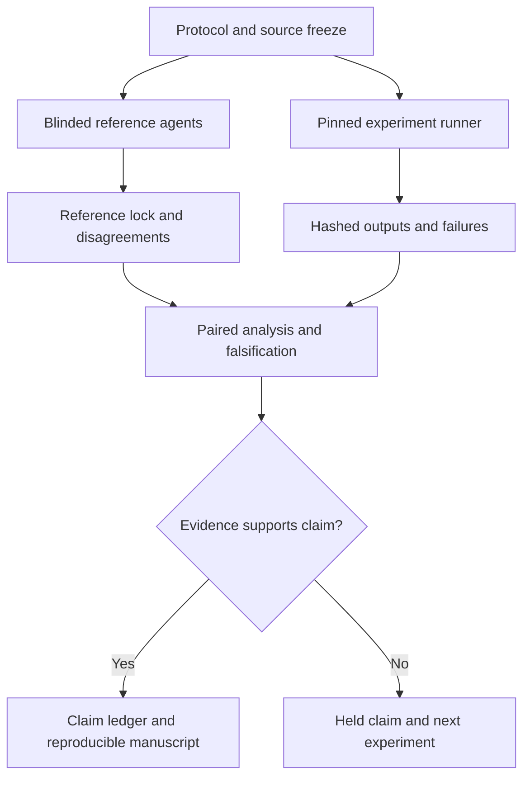

# StandardFlow publication protocol 0.1.0

Status: **draft, not frozen, no new experiment results**. Owner: Dylan A. Mordaunt.
Track 01 owns sources and representation, Track 04 consumer exchange, and Track 05
research assurance. Related issues: #111, #118, #82, #95 and the #155 experiment lane.
The [interoperability profile](../architecture/REPORTING_GUIDELINE_INTEROPERABILITY.md)
and existing pack schemas retain authority. This protocol plans how to evaluate them.

## Contents

- [Publication questions](#publication-questions)
- [Design and analysis](#design-and-analysis)
- [Agent workflow](#agent-workflow)
- [Contract and evidence](#contract-and-evidence)
- [Release and dissemination](#release-and-dissemination)
- [Primary references](#primary-references)

## Publication questions

| Output | Research question and contribution to test | Required evidence |
| --- | --- | --- |
| Versioned technical profile | Can one implementation-neutral representation preserve edition, requirement, applicability, rights and evidence semantics across diverse reporting guidelines? | Prior-art comparison, normative assertions, synthetic/rights-cleared examples, executable conformance tests, version and migration history, stakeholder feedback. |
| Empirical methods paper | Which source formats, requirement structures and guideline families expose failures, and does adding orthogonal evidence improve reconciliation? | Frozen directory census, source-level comparisons, independent model-agent reference, five-class and calibration results, ablations, complete denominators and failed runs. |
| Software paper, conditional | Does the released reference implementation provide usable and reproducible research functionality? | Actual release, documented use, consumer import/export, accessibility and reproducible-build receipts; check the chosen journal's current requirements. |

Do not split identical findings into multiple papers. The profile describes a proposed
technical contract; the implementation demonstrates one way to satisfy it. Neither is a
new study-design reporting guideline. Novelty and external acceptance remain hypotheses.

### Initial prior-art comparison

| Prior work | Established overlap | Specific comparison still required |
| --- | --- | --- |
| FAIRsharing MIRcat and JSON-ScheeLD [7] | Machine-readable reporting guidelines using JSON Schema/JSON-LD, comparison and directional composition, provenance and CEDAR export. | Test source-faithful reconstruction, edition/rights distinctions, explicit obligation relations and measured cross-method assurance against its actual capabilities. |
| CEDAR [8] | Machine-actionable metadata templates, controlled terms, validation, versioned publication and generated forms. | Assess whether a thin exchange with existing templates can replace custom metadata/form work while preserving reporting-source anchors and uncertainty. |
| EQUATOR directory and issuing groups [5] | Guideline discovery and authoritative reporting guidance. | Compare descriptive catalogue metadata with item-level representation; never infer content rights or endorsement. |

This is a starting comparison, not an exhaustive novelty search. Machine-readable guidelines,
schema composition and generated forms are established ideas. The contribution to investigate
is auditable source/edition reconstruction, directional semantic reconciliation and quantified
assurance across heterogeneous reporting standards. Document a concrete gap before claiming it.

## Design and analysis

### E1: Directory-wide representation and source census

Freeze the exact upstream directory commit, retrieval receipt and inventory hash. Include
every published entry in that snapshot, retaining duplicate/ambiguous identities, unresolved
rights, missing sources, unsupported formats and failed retrievals. Identify editions before
counting edition-level outcomes; report entry and edition denominators separately. Reuse the
existing catalogue survey, extraction, reconciliation and Parquet projection commands.

Primary outcome: the proportion of directory entries for which complete item-level source
reconciliation is documented, with numerator, denominator and reasons for every held entry.
This is a descriptive census, not a pass/fail target. Catalogue discovery, acquisition,
structural reconstruction, textual concordance, rights and semantic qualification are separate
outcomes. A successful extraction alone cannot enter the primary numerator. Report strata by
format, family, language, edition, source availability and structural complexity. Do not infer
missing-at-random mechanisms or silently exclude unsuccessful sources.

### E2: Five-class reconciliation and assurance

Freeze an untouched family-level evaluation set before model predictions or adjudication.
Keep all editions, extensions, translations, repeated anchors and paraphrases of a family in
one split. Retain the existing 33-pair development fixture as development evidence. Keep
natural, independently selected requirement pairs separate from synthetic logical controls.
The natural set estimates use-case performance; a balanced challenge set probes class failures
and cannot estimate directory-wide class prevalence. Document potential model training overlap.

Define relations over the same applicability universe and directed argument order: equivalent,
narrower, broader, contradictory and indeterminate. Use the repository's existing executable
relation semantics, with inverse-pair tests. Omission is not contradiction; an incomplete source
is not a negative label. Compound requirements need explicit scope and a supported witness.

Run three adjudicator agents independently with fresh contexts. Give each exact allowed source
anchors and the same rubric, withholding algorithmic predictions, expected labels, peer answers
and development labels. Record actual model/version, prompt hash, source hashes and run IDs.
Separate initial labels from a later blinded discrepancy resolver. A label requires anchored
rationale and, where applicable, an implication/counterexample witness. Unresolved disagreements
remain indeterminate or held. Report unanimity, disagreement and label stability. These labels
are a **model-agent reference**, not human consensus or independent ground truth. Different
agent sessions do not establish independent model errors.

Primary outcome: reference-relative false equivalence among predicted-equivalent outputs
with a usable locked reference. The numerator is such outputs whose usable reference disagrees;
the denominator includes only predicted-equivalent outputs with a usable locked reference.
Report unresolved equivalent predictions and reference coverage separately; they cannot dilute
the error rate. A resolved, source-supported indeterminate relation is a reference class,
whereas unresolved adjudication supplies no usable reference. Report the full five-class
confusion matrix, class precision/recall, directional inversions, material omissions, coverage
and abstention, by family and format. Report uncertainty clustered by
guideline family; with too few independent families, report counts and describe the limitation
instead of treating correlated pairs as independent observations. Predeclare sampling, target
family counts, confidence method and numerical adoption limits in the contract before freeze.
Current draft deliberately makes no numerical adoption decision.

### E3: Incremental triangulation with a decision model

Evaluate one additional method at a time against the retained baseline on the same frozen
inputs. Liquid AI's [d1-2B model card](https://huggingface.co/LiquidAI/d1-2B) describes a
decision model based on LFM3-VL-2B, returning typed probabilities without token generation.
Its provider calibration and speed claims are not StandardFlow task qualification. Resolve
the exact model, code, tokenizer, licence and runtime revisions before execution. The current
repository prohibition on remote model code remains: use reviewed, pinned local code in an
isolated qualified lane if approved by the repository policy; do not enable remote code to
make this experiment run.

The candidate need not outperform the baseline as a standalone classifier. Its proposed role
is to flag additional supported discrepancies and uncertainty. Primary outcome: additional
reference-confirmed material errors per 100 reviewed pairs at a fixed, predeclared review
budget. Compare baseline-only triage with baseline plus candidate, retaining ties and all
abstentions. Report paired error overlap, unique catches, jointly missed errors, spurious flags,
harmful changed decisions, latency, peak memory, input length and cost. Measure Brier/log loss
and risk–coverage in this domain; calibrate only on development data.

Predeclare the review budget, minimum useful gain and tolerated added error before seeing
evaluation results. An inconclusive result leaves the candidate experimental. Disagreement
is a reason to investigate, not automatic truth; agreement is not automatic admission. Keep
decisions advisory while the statistical and source gates remain incomplete. No model vote
may promote a canonical pack or replace issuer wording.

### Robustness and amendments

Reuse formal controls, independent readers, source-byte and ordered-row checks, inverse
relations, scope/negation/quantifier perturbations and format-preserving transformations.
Evaluate one method ablation at a time and report the full sequence. Freeze the confirmatory
analysis before execution; adaptations suggested by directory-scale errors are exploratory
and need a new version and untouched evaluation families. Preserve earlier failures and
negative results. Do not select a favourable run and present it as predeclared.

## Agent workflow

Use the [publication-evidence skill](../../.agents/skills/publication-evidence/SKILL.md)
and existing executable experiment lanes. This is a task contract for available agents,
not a new orchestration service or a claim that a model has run.

| Role | Input boundary | Output and verification |
| --- | --- | --- |
| Protocol coordinator | Current Conductor, sources and prior-art evidence | Question, frozen design, budgets, split manifest, amendments and stop rules. |
| Source curator | Issuer/EQUATOR sources and source receipts | Immutable identity, source/rights/anchor ledger; no inferred permission. |
| Adjudicators A/B/C | Source-only blinded packets and relation rubric | Independent label, uncertainty and anchored witness; no prediction access. |
| Discrepancy resolver | Initial labels and permitted source evidence after label lock | Resolution with reasons, or a held case; still no algorithmic predictions. |
| Experiment runner | Frozen design and pinned implementation | Existing harness outputs, command/log, resource use and all failures. |
| Analyst and adversarial reviewer | Frozen outputs and reference labels | Paired metrics, negative controls, sensitivity checks, alternative explanations and claim limits. |
| Writer and citation verifier | Verified claim ledger and original publications | Manuscript linked to exact tables/figures and sources; unsupported claims remain withheld. |



The bounded experiment-manager and ablation approach is informed by the AI Scientist work
[1]. Artifact-grounded claim review and withheld conclusions are informed by recent
TruthInsightBench and ResearchClawBench research [2, 3]. These papers motivate design choices;
they do not validate this harness, justify autonomous acceptance, or establish novelty here.
Use existing command-line scripts and CI for deterministic checks. Cap agent work and revise
the plan when a concrete error changes the experiment; avoid open-ended paper generation.

## Contract and evidence

The machine-readable plan is
[`contracts/publication/programme.v1.json`](../../contracts/publication/programme.v1.json).
Run the offline integrity harness with:

```sh
python scripts/validate_publication_contract.py
python -m unittest tests.test_publication_contract -v
```

The contract's `design` contains the protocol hash, experiments, declared endpoints and input
identities. `freeze.design_sha256` hashes canonical JSON of that complete design (sorted keys,
compact separators, UTF-8 with non-ASCII preserved). A frozen contract additionally records the
commit, timestamp and a hashed decision record. Verify that Git history really predates runs;
the local validator checks the declaration and hash consistency, not historical truth.

Runs record command, exact implementation commit, start time, design hash, exit code and hashed
local input/output receipts. Each completed run requires a log and results artifact. Claims
may be planned, held or observed; observed claims require a completed run and a hashed review
artifact. Failed runs remain in the ledger. The validator does not determine scientific
correctness, rights, genuine reviewer independence or authenticity of supplied logs. It never
assigns accepted, endorsed, published or scientifically validated status. Claim review remains
an explicit evidence evaluation with material limits stated in the manuscript.

This initial contract has no freeze, inputs, run receipts or observed claims. Completing its
unresolved sample-size, model-integrity and decision-threshold fields is required before an
experimental freeze. A post-freeze protocol amendment changes its version/hash and creates a
new design freeze in a **new versioned contract path**. Preserve the original design, freeze,
all runs (including failures), artifacts and claims in their original version. Link the
amendment decision to the previous version and apply the baseline history guard when updating
an existing ledger. Never rehash an altered design in place, delete an unfavourable run, or
rewrite results that cite an earlier freeze.

## Release and dissemination

Maintain one canonical claim ledger and generated tables from retained machine-readable
outputs. Record the exact source snapshot, code/environment/model pins, seeds, exclusion and
hold logs, bibliography, disclosure of AI use, and permitted reproduction instructions.
Package a release manifest first; use RO-Crate provenance only when a concrete exchange needs
it [4]. Deposit code/data/profile versions with an appropriate persistent identifier when ready.
Do not redistribute rights-unclear source wording or infer a reuse licence from a listing.

Offer EQUATOR the proposed technical specification **and** an optional reference implementation
through #118. Ask about identifiers, editions, rights and a feedback route. EQUATOR's reporting
guideline registration is for reporting recommendations, and is not endorsement [5]; verify
the appropriate route for this technical work. Record the actual external issue URL and response.
Keep technical implementation, stakeholder acceptance and publication acceptance separate.

Agent labelling and analysis can proceed without a human-labelled benchmark. Accountable
authors must still verify and approve a submitted manuscript, and disclose AI assistance in
line with the target journal's policy; ICMJE excludes AI tools from authorship [6]. No submission
or outreach is performed by this validator or by this protocol.

## Primary references

1. Lu et al. *Towards end-to-end automation of AI research*. Nature 651, 914–919 (2026).
   [doi:10.1038/s41586-026-10265-5](https://www.nature.com/articles/s41586-026-10265-5).
   The paper describes staged experimentation and also reports limitations; adopt the workflow
   discipline, not its acceptance claims as evidence for StandardFlow.
2. Yang et al. *TruthInsightBench* (2026), preprint v2.
   [arXiv:2609.05079v2](https://arxiv.org/abs/2609.05079v2).
3. Xu et al. *ResearchClawBench* (2026), preprint v5.
   [arXiv:2606.07591v5](https://arxiv.org/abs/2606.07591v5).
4. [Workflow Run RO-Crate](https://www.researchobject.org/workflow-run-crate/).
5. [EQUATOR registration scope and disclaimer](https://equator-network.org/toolkits/developing-a-reporting-guideline/registration.html).
6. [ICMJE: AI use by authors](https://www.icmje.org/recommendations/browse/artificial-intelligence/ai-use-by-authors.html).
7. Batista et al. *Machine actionable metadata models*. Scientific Data 9, 592 (2022).
   [doi:10.1038/s41597-022-01707-6](https://pmc.ncbi.nlm.nih.gov/articles/PMC9525592/).
8. [CEDAR tutorial and metadata model](https://metadatacenter.readthedocs.io/en/latest/tutorials/cedar_tutorial/).
