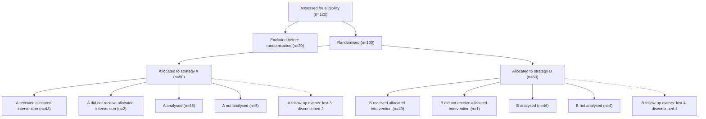

# Trial reporting examples — candidate diagrams, 2025

These original **synthetic** illustrations identify useful design requirements for
future rights-qualified [CONSORT 2025](https://doi.org/10.1136/bmj-2024-081123)
and [SPIRIT 2025](https://doi.org/10.1136/bmj-2024-081477) artefacts. They are
**not official figures**, source-verified checklists, generated Standard Packs, or
a claim of methodological or accessibility certification. No publisher figure
or checklist item text has been copied. See
[qualification issue #120](https://github.com/edithatogo/standards_check/issues/120).

## CONSORT-informed two-group participant-flow example

All values are invented aggregate test data. The reporting stages are generic:
eligibility, randomisation, allocation, follow-up and analysis.

**Text equivalent:** 120 people were assessed; 20 were excluded and 100 were
randomised, 50 to each strategy. In A, 48 received the allocated intervention
and two did not; 45 were analysed and five were not. In B, 49 received the
allocated intervention and one did not; 46 were analysed and four were not.
Recorded follow-up events were loss to follow-up (A 3, B 4) and intervention
discontinuation (A 2, B 1). These event categories can overlap and are
**not** subtracted from allocation or automatically equated with analysis
exclusion. The diagram illustrates numbers only and does not imply a specific
analysis population, missing-data mechanism, or trial estimand.

Count assertions: 120 = 20 + 100; 100 = 50 + 50; A allocation 50 = 48 + 2
and 45 + 5; B allocation 50 = 49 + 1 and 46 + 4.
A retained [regression](../../tests/test_trial_reporting_examples.py) enforces
these aggregate identities. A future operational generator must validate
individual source streams and preserve protocol/report semantics before admission.

## SPIRIT-informed study-schedule example

A schedule matrix is more appropriate than a participant-flow figure for
protocol planning. The following is an invented sequence and must be replaced
with the protocol's actual time windows, interventions, visit requirements and
optional/conditional activities.

| Protocol activity | Before allocation | Baseline (day 0) | Week 4 | Week 12 |
| --- | :---: | :---: | :---: | :---: |
| Eligibility screening | X | | | |
| Consent | X | | | |
| Randomisation | | X | | |
| Study strategy administered | | X | X | |
| Primary outcome assessment | | X | X | X |
| Adverse-event assessment | | X | X | X |

**Text equivalent:** screening and consent precede allocation. Randomisation
and the initial intervention occur at baseline; further intervention is
scheduled at week 4. The illustrative outcome and safety assessments occur
at baseline, week 4 and week 12. Actual protocol windows and exceptional
visits are not specified by this example.

## Authority and next implementation gate

- CONSORT 2025: BMJ 2025;389:e081123 (published 14 April 2025), 30
  main checklist items plus a participant-flow diagram.
- SPIRIT 2025: BMJ 2025;389:e081477 (published 28 April 2025), 34
  main checklist items plus a schedule-of-enrolment/interventions/assessments diagram.
- TRIPOD+AI 2024: BMJ 2024;385:e078378 (published 16 April 2024), 27
  main items, superseding TRIPOD 2015; added as *source metadata only*
  in [source/index.yml](../../source/index.yml).

The primary BMJ statement articles advertise CC BY 4.0. The source-index
licence describes those works, not blanket permission for every linked
supplement, figure adaptation, edition or other publisher's reproduction.
Before a **canonical** pack or generated diagram is admitted, pin actual
source bytes and licence scope; reconcile every item, subitem and source
anchor; review interpretations; validate model arithmetic and a text
equivalent; and record independent review and version-specific CI evidence.
Reuse the existing Rust recipe/scene renderer rather than creating a second
diagram framework. [EQUATOR catalogue #111](https://github.com/edithatogo/standards_check/issues/111)
remains descriptive discovery only; [held-candidate #95](https://github.com/edithatogo/standards_check/issues/95)
retains its existing rights and source-adjudication gates.
