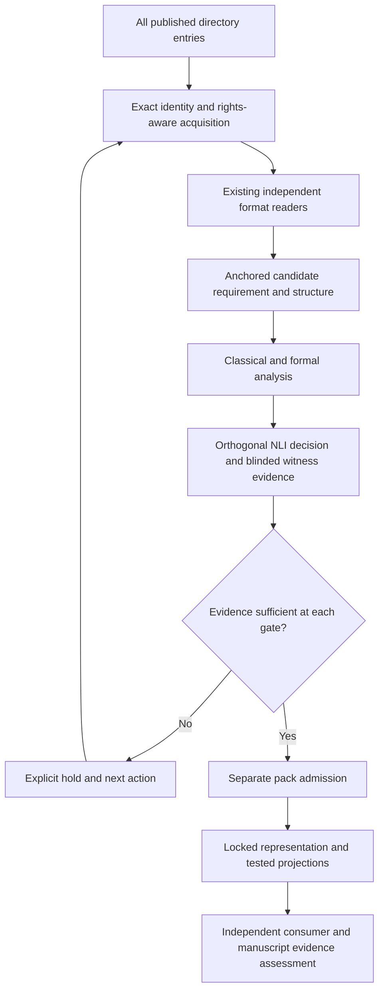

# Reporting guideline interoperability and assurance profile 0.2.0

**Draft.** This is an implementation-neutral technical representation and assurance
profile, not a new study-reporting guideline, an EQUATOR endorsement, a rights
clearance, or a conformance certificate. Canonical Standard Pack v1 is the
experimental reference implementation. The normative object model remains in
its existing JSON schemas; no competing canonical format is introduced.

## Proposed requirements

| ID | Priority | Conformance requirement |
| --- | --- | --- |
| RGI-01 | Must | Identify issuing authority, family, exact edition and language, stable identifiers, citations, versions, extensions, translations and supersession. A directory slug is not an authoritative edition identifier. |
| RGI-02 | Must | Bind source artifacts to URI, retrieval evidence, byte hash, media type, and work/item-specific rights including figures and translations. Catalogue inclusion does not confer permission. |
| RGI-03 | Must | Conserve printed and stable IDs, sequence, section hierarchy, subitems, source wording where permitted, source anchors, cross-format fidelity, and unknown versus not applicable. |
| RGI-04 | Must | Separate verbatim text, normalized requirement, guidance, interpretation, and manuscript evidence. Do not replace authoritative text silently. |
| RGI-05 | Must | Preserve actor, action, object, modality, quantification, evidence expectation, conditionality, exceptions, time and coordination. Hold unresolved scope. |
| RGI-06 | Must | Represent equivalent, narrower, broader, contradictory and indeterminate mappings over an explicit common applicability universe; preserve directional evidence, uncertainty and witnesses. |
| RGI-07 | Must | Distinguish discovery, source acquisition, structural extraction, source fidelity, rights, interpretation, applicability, interoperability, accessibility and external qualification. Held is not failed compliance or accepted conformance. |
| RGI-08 | Must | Use content-addressed versions, exact source/runtime pins, stable keys, deterministic schema/order/value conservation, and reproducible derived exports. Parquet is not canonical authority. |
| RGI-09 | Must | Retain source/model/prompt/runtime/fixture provenance, disjoint family-level evaluation, error and abstention counts, calibration, resources, limitations and negative receipts. No self-adjudicated validation. |
| RGI-10 | Must | Separate requirement interpretation from manuscript evidence assessment and reporting completeness from methodological quality. |
| RGI-11 | Should | Provide accessible checklist/diagram views and tested consumer import/export; fail closed on wrong editions and unresolved mappings. |
| RGI-12 | Should | Reuse JSON Schema, SPDX, PROV-O, DCAT, SKOS with explicit directional semantics, and RO-Crate where appropriate; avoid speculative ontology or service expansion. |
| RGI-13 | Could | Support cross-edition semantic diffs, cross-guideline coverage, official translations and extractive manuscript evidence. |
| RGI-14 | Won't | Claim institutional endorsement, redesign issuing-group recommendations, copy rights-unclear material, or infer universal report quality. |
| RGI-15 | Must | Account for the whole published directory at each pinned census, preserve a disposition for every entry and eligible source, and resume bounded acquisition without losing unresolved identities or prior evidence. |
| RGI-16 | Must | Keep versioned profile text immutable after registration; record approval and withdrawal separately with exact version, owner decision, date and evidence. A code merge, green CI or stakeholder discussion is not approval. |
| RGI-17 | Must | Treat orthogonal inference as supplementary evidence: preserve independent outputs, correlated failures and disagreements; measure incremental error coverage and safe abstention, not solely standalone accuracy. No vote overrides source/rights/interpretation gates. |
| RGI-18 | Must | Bind publication claims to immutable evidence receipts and a prospective evaluation protocol; separate model-agent consensus from independent truth and preserve accountable human author approval. |

## Candidate pipeline

## Conformance and revision governance

Conformance is per assertion and exact implementation/profile version. Record
pass, fail, held or not applicable with justification and source/receipt links;
no blanket conformance from a single passing example. Use the existing
schema, source-manifest, lock and ecosystem-evidence contracts. No mandatory
model, library, vendor, API or deployment stack. Version 0.1.0 is the immutable
historical draft; 0.2.0 expands directory coverage, orthogonal inference,
version approval and publication lineage. Future changes require a new snapshot,
change rationale, compatibility assessment, tests and separate approval.
